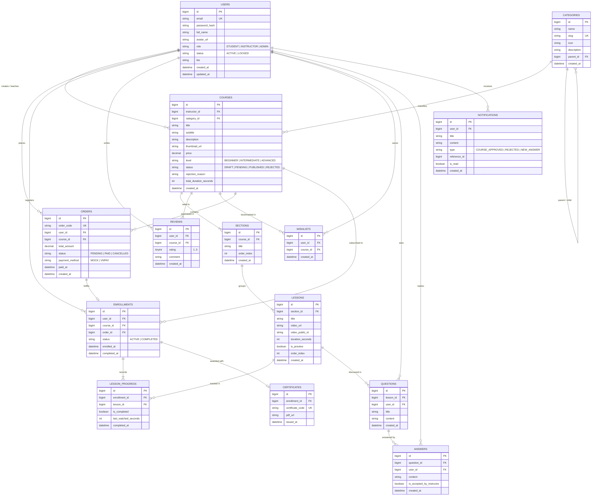

# Sơ đồ Cơ sở Dữ liệu Tổng thể (ERD) - Edumy App

> **Mã công việc:** W7-T1  
> **Phiên bản:** v1.0 (Khóa theo Kickoff D1)  
> **File DBML nguồn:** [`erd.dbml`](file:///C:/Users/bacle/.gemini/antigravity-ide/scratch/Edumy-App/docs/erd.dbml) (Dùng để import trực tiếp vào [dbdiagram.io](https://dbdiagram.io))  
> **Ảnh sơ đồ trực quan:** [`erd.png`](file:///C:/Users/bacle/.gemini/antigravity-ide/scratch/Edumy-App/docs/erd.png)

---

## 1. Sơ đồ Quan hệ Thực thể (Mermaid ERD)

---

## 2. Từ điển Dữ liệu Chi tiết (Data Dictionary)

### 2.1. Phân hệ Người dùng & Xác thực (Member A)
* **`users`**:
  * `id`: Khóa chính (Auto Increment).
  * `email`: Email đăng nhập duy nhất (`UNIQUE`, `NOT NULL`).
  * `password_hash`: Chuỗi mật khẩu băm BCrypt.
  * `role`: Phân quyền người dùng (`STUDENT`, `INSTRUCTOR`, `ADMIN`).
  * `status`: Trạng thái kích hoạt (`ACTIVE`, `LOCKED` khi bị Admin xử lý).

### 2.2. Phân hệ Danh mục, Khóa học & Đánh giá (Member B)
* **`categories`**: Quản lý cây danh mục (hỗ trợ `parent_id` cho danh mục con).
* **`courses`**:
  * `status`: Quản lý vòng đời xuất bản: `DRAFT` (mới tạo) $\rightarrow$ `PENDING` (chờ duyệt) $\rightarrow$ `PUBLISHED` (đã duyệt, hiển thị Catalog) hoặc `REJECTED` (bị từ chối kèm `rejection_reason`).
  * `price`: Giá bán (0.00 là khóa học miễn phí).
* **`wishlists`**: Danh sách lưu yêu thích (ràng buộc unique `[user_id, course_id]`).
* **`reviews`**: Đánh giá 1-5 sao và nhận xét (chỉ cho phép khi người dùng đã enroll).

### 2.3. Phân hệ Giảng trình & Bài học Video (Member C)
* **`sections`**: Chương học trong khóa, sắp xếp theo `order_index`.
* **`lessons`**:
  * `video_url`: Đường dẫn stream video từ Cloudinary.
  * `video_public_id`: ID quản lý asset trên Cloudinary để phục vụ xóa/thay thế.
  * `duration_seconds`: Thời lượng video tính bằng giây.
  * `is_preview`: Cờ cho phép học viên chưa mua xem thử (Preview lesson).

### 2.4. Phân hệ Đơn hàng, Học tập & Chứng chỉ (Member D)
* **`orders`**: Ghi nhận giao dịch mua khóa học. Tạo mã `order_code` ngẫu nhiên. Trạng thái `PENDING` $\rightarrow$ `PAID`. Hỗ trợ phương thức `MOCK` và `VNPAY`.
* **`enrollments`**: Xác nhận quyền học. Một học viên chỉ có 1 bản ghi enrollment cho mỗi khóa học (`UNIQUE(user_id, course_id)`).
* **`lesson_progress`**: Ghi nhận tiến độ xem từng bài học. Tự động chuyển `is_completed = true` khi xem $\ge 90\%$.
* **`certificates`**: Cấp khi toàn bộ bài học trong khóa đều đạt `is_completed = true`. Mã chứng chỉ `certificate_code` định dạng `EDUMY-<YEAR>-<RANDOM>` có thể tra cứu công khai.

### 2.5. Phân hệ Quản trị & Hỏi đáp Cộng đồng (Member E)
* **`questions`**: Thắc mắc của học viên gắn với từng bài học cụ thể.
* **`answers`**: Lời giải đáp từ cộng đồng hoặc giảng viên. Giảng viên có quyền tick `is_accepted_by_instructor = true`.
* **`notifications`**: Thông báo trong app khi khóa học được duyệt, bị từ chối hoặc có phản hồi câu hỏi.

---

## 3. Quy ước Đặt tên & Migration (Flyway)
1. Bảng dùng danh từ số nhiều, viết thường theo kiểu `snake_case` (`users`, `courses`, `lesson_progress`).
2. Khóa chính luôn là `id BIGINT AUTO_INCREMENT`.
3. Khóa ngoại đặt tên theo thực thể cha: `<singular_table_name>_id` (ví dụ `course_id`, `user_id`).
4. Toàn bộ file migration trong Spring Boot lưu tại `/backend/src/main/resources/db/migration/` và đặt tên theo timestamp chuẩn để không xung đột:  
   `V20261027_01__create_users.sql`, `V20261027_02__create_courses.sql`...
