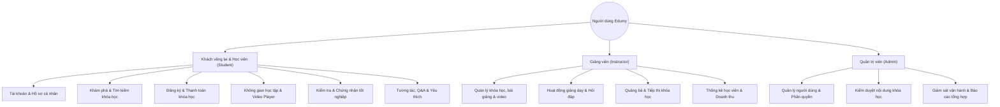

# Tổng Quan Chức Năng & Tính Ứng Dụng Thực Tế — Edumy Platform

Tài liệu này mô tả bức tranh tổng thể về **Tầm nhìn sản phẩm (Product Vision)**, **Hệ thống tính năng chi tiết theo phân quyền** và **Tính ứng dụng thực tế** của nền tảng học tập trực tuyến Edumy.

---

## 1. Hệ thống chức năng chính (Functional Breakdown)

Hệ thống được thiết kế phục vụ 3 nhóm đối tượng người dùng chính với các đặc quyền và nghiệp vụ chuyên biệt:



---

### A. Phân hệ Khách truy cập & Học viên (Guest & Student)

| Nhóm nghiệp vụ | Danh sách chức năng chi tiết | Phân kỳ thực hiện |
| :--- | :--- | :---: |
| **Tài khoản cá nhân** | • Đăng ký tài khoản (chọn vai trò Học viên hoặc Giảng viên)<br>• Đăng nhập an toàn qua JWT Token (hỗ trợ refresh token tự động)<br>• Cập nhật thông tin cá nhân, tải ảnh đại diện (Avatar)<br>• Đổi mật khẩu, quản lý phiên đăng nhập | **Giai đoạn 1 (MVP)** |
| **Khám phá khóa học** | • Xem danh mục khóa học phân cấp (Categories)<br>• Tìm kiếm toàn văn (keyword) và lọc theo nhiều tiêu chí (giá, rating, cấp độ)<br>• Xem trang chi tiết: giáo trình (curriculum), thông tin giảng viên, đánh giá học viên<br>• Xem trước (Preview) các bài giảng video miễn phí | **Giai đoạn 1 (MVP)** |
| **Đăng ký & Thanh toán** | • Đăng ký trực tiếp đối với các khóa học miễn phí (0đ)<br>• Mua khóa học trả phí: Mock Checkout & Cổng thanh toán VNPay Sandbox<br>• Lưu lịch sử đơn hàng (Order History) và trạng thái thanh toán<br>• *Mở rộng:* Giỏ hàng nhiều khóa học (Shopping Cart), mã giảm giá (Coupon/Voucher) | **GĐ 1: Khóa 0đ + VNPay**<br>*GĐ 2: Giỏ hàng + Voucher* |
| **Không gian học tập** | • Trình phát video chuyên dụng (`expo-video`) streaming bài giảng mượt mà<br>• Đọc tài liệu bài học đính kèm<br>• Tự động ghi nhớ vị trí xem dở (Resume learning)<br>• Theo dõi thanh tiến độ khóa học (quy tắc hoàn thành $\ge 90\%$ thời lượng) | **Giai đoạn 1 (MVP & Mở rộng)** |
| **Kiểm tra & Chứng nhận** | • Làm Quiz trắc nghiệm, bài tập ôn tập, bài thi thử đánh giá kiến thức<br>• Hệ thống tự động chấm điểm và kiểm tra điều kiện hoàn thành khóa học<br>• Tự động cấp Chứng nhận hoàn thành (Certificate PDF) có mã định danh xác thực | **GĐ 1: Chứng chỉ PDF**<br>*GĐ 2: Quiz & Bài tập* |
| **Tương tác & Cá nhân hóa** | • Đặt câu hỏi thảo luận (Q&A) trực tiếp dưới từng bài học, nhận phản hồi từ giảng viên<br>• Đánh giá số sao (Rating) và viết nhận xét (Review) sau khi học<br>• Lưu danh sách khóa học yêu thích (Wishlist)<br>• *Mở rộng:* Ghi chú cá nhân trong khi xem video (Timestamped Notes) | **GĐ 1: Q&A + Review + Wishlist**<br>*GĐ 2: Ghi chú video* |

---

### B. Phân hệ Giảng viên (Instructor Studio)

| Nhóm nghiệp vụ | Danh sách chức năng chi tiết | Phân kỳ thực hiện |
| :--- | :--- | :---: |
| **Quản lý khóa học** | • Tạo mới, cập nhật thông tin tổng quan khóa học (tiêu đề, mô tả, giá, thumbnail)<br>• Quản lý cấu trúc cây giáo trình: Chương học (Sections) $\rightarrow$ Bài học (Lessons)<br>• Sắp xếp lại thứ tự bài giảng trực quan (Reorder)<br>• Tải video bài học trực tiếp từ ứng dụng lên Cloudinary có thanh tiến độ<br>• Gửi khóa học vào hàng chờ phê duyệt (Submit for Review) | **Giai đoạn 1 (MVP)** |
| **Quản lý hoạt động dạy** | • Theo dõi câu hỏi của học viên theo từng bài học và phản hồi giải đáp<br>• Đánh dấu câu trả lời đúng / giải pháp hữu ích<br>• *Mở rộng:* Tạo bộ câu hỏi Quiz/Bài tập cho từng bài giảng; gửi thông báo broadcast tới học viên | **GĐ 1: Hỏi đáp Q&A**<br>*GĐ 2: Soạn Quiz & Broadcast* |
| **Quảng bá & Tiếp thị** | • Thiết lập chương trình khuyến mãi, giảm giá khóa học theo thời điểm<br>• Tạo mã coupon giảm giá riêng của giảng viên<br>• Sinh liên kết giới thiệu (Affiliate / Referral Link) để chia sẻ | **Giai đoạn 2 (Backlog)** |
| **Theo dõi hiệu quả** | • Dashboard giảng viên: Thống kê tổng số khóa học đã xuất bản, tổng lượt học viên<br>• Biểu đồ doanh thu tạm tính và tỷ lệ hoàn thành bài học<br>• Danh sách học viên đã ghi danh theo từng khóa học<br>• Theo dõi phản hồi đánh giá và điểm xếp hạng trung bình | **Giai đoạn 1 (Mở rộng)** |

---

### C. Phân hệ Quản trị viên hệ thống (Admin & Operations)

| Nhóm nghiệp vụ | Danh sách chức năng chi tiết | Phân kỳ thực hiện |
| :--- | :--- | :---: |
| **Quản lý hệ thống** | • Quản lý danh sách tài khoản người dùng, phân quyền vai trò (Role)<br>• Khóa (Lock) hoặc Mở khóa (Unlock) tài khoản khi phát hiện dấu hiệu bất thường<br>• Quản trị danh mục khóa học (Category CRUD: Tạo, sửa, xóa, gắn icon) | **Giai đoạn 1 (MVP)** |
| **Kiểm duyệt nội dung** | • Hàng chờ duyệt khóa học (Pending Review Queue): Xem chi tiết nội dung, video bài giảng<br>• Phê duyệt (Approve) để khóa học xuất bản lên trang chủ, hoặc Từ chối (Reject) kèm lý do chi tiết<br>• *Mở rộng:* Xử lý báo cáo vi phạm bản quyền / nội dung độc hại từ cộng đồng | **GĐ 1: Duyệt/Từ chối khóa**<br>*GĐ 2: Xử lý Report vi phạm* |
| **Giám sát vận hành** | • Admin Dashboard: Báo cáo tổng thể tốc độ tăng trưởng người dùng, khóa học mới<br>• Thống kê doanh thu nền tảng và số lượng đơn hàng theo tháng<br>• Theo dõi nhật ký giao dịch thanh toán (Transaction Logs)<br>• *Mở rộng:* Quy trình xử lý khiếu nại và hoàn tiền (Refund policy) | **GĐ 1: Dashboard & Giao dịch**<br>*GĐ 2: Hoàn tiền (Refund)* |

---

## 2. Phân kỳ lộ trình: Đồ án 4 tuần vs Định hướng mở rộng

Để đảm bảo dự án về đích đúng hạn D28 mà vẫn giữ được chất lượng cao nhất, các tính năng được phân định rõ ràng thành 2 phân kỳ:

```text
┌────────────────────────────────────────────────────────────────────────┐
│                      GIAI ĐOẠN 1: ĐỒ ÁN 4 TUẦN (D1 - D28)              │
│  • Đăng ký/đăng nhập JWT 3 role (Student, Instructor, Admin)           │
│  • Khám phá, tìm kiếm lọc khóa học, Wishlist, Đánh giá & Xếp hạng      │
│  • Giảng viên tạo khóa, tải video lên Cloudinary, gửi duyệt           │
│  • Admin duyệt/từ chối khóa học, quản lý danh mục, khóa tài khoản      │
│  • Mua khóa học (Mock checkout + VNPay Sandbox), Trình phát video      │
│  • Hỏi đáp Q&A theo bài giảng, Theo dõi tiến độ học                    │
│  • Sinh và tải Chứng chỉ PDF hoàn thành khóa học                       │
│  • Dashboard thống kê số liệu cho Instructor và Admin                  │
└───────────────────────────────────┬────────────────────────────────────┘
                                    │ Kế thừa & mở rộng kiến trúc
                                    ▼
┌────────────────────────────────────────────────────────────────────────┐
│                   GIAI ĐOẠN 2: HƯỚNG PHÁT TRIỂN TƯƠNG LAI              │
│  • Hệ thống Quiz trắc nghiệm, bài thi thử có chấm điểm tự động         │
│  • Giỏ hàng nhiều khóa học (Cart), Mã giảm giá (Coupon code)           │
│  • Tính năng ghi chú video theo mốc thời gian (Timestamped Notes)      │
│  • Báo cáo vi phạm nội dung và luồng xử lý hoàn tiền (Refund)          │
│  • Tải video học ngoại tuyến (Offline download DRM), Đa ngôn ngữ       │
└────────────────────────────────────────────────────────────────────────┘
```

---

## 3. Tính ứng dụng thực tế (Practical Applicability)

Nền tảng Edumy không chỉ dừng lại ở một ứng dụng mẫu mà được thiết kế nhằm giải quyết các bài toán chuyển đổi số giáo dục trong thực tiễn:

### 🎓 1. Đối với người học (Students & Lifelong Learners)
- **Học tập linh hoạt, xóa nhòa khoảng cách:** Tiếp cận nguồn tri thức chất lượng cao mọi lúc, mọi nơi ngay trên thiết bị di động Android.
- **Tối ưu hóa thời gian tự học:** Cơ chế tự động lưu tiến độ và ghi nhớ bài học giúp người học bận rộn dễ dàng duy trì việc học liên tục mà không bị gián đoạn.
- **Minh chứng năng lực:** Chứng nhận hoàn thành có mã số định danh rõ ràng, có thể dùng để bổ sung vào hồ sơ năng lực (CV, LinkedIn).

### 👨‍🏫 2. Đối với giảng viên & chuyên gia (Content Creators & Experts)
- **Kênh phân phối tri thức không giới hạn:** Giúp các chuyên gia, giảng viên tự do tiếp cận hàng ngàn học viên trên toàn quốc mà không cần đầu tư hạ tầng phần mềm đắt đỏ.
- **Tạo nguồn thu nhập thụ động bền vững:** Giảng viên đóng gói kiến thức thành các khóa học số và thu phí tự động từ mỗi lượt ghi danh.
- **Công cụ tương tác gắn kết:** Phân hệ hỏi đáp (Q&A) giúp giảng viên lắng nghe thắc mắc, chăm sóc và nâng cao chất lượng bài giảng theo thời gian thực.

### 🏛️ 3. Đối với cơ sở đào tạo & trường học (Educational Institutions)
- **Chuyển đổi số mô hình đào tạo (Blended Learning):** Dễ dàng triển khai mô hình học kết hợp giữa giảng đường truyền thống và nội dung số hóa trực tuyến.
- **Chuẩn hóa nội dung và đánh giá minh bạch:** Nội dung bài giảng được lưu trữ tập trung, kiểm soát chất lượng qua quy trình kiểm duyệt (Approval Workflow) trước khi công bố.

### 🏢 4. Đối với doanh nghiệp (Corporate Training & Onboarding)
- **Chuẩn hóa quy trình Onboarding nhân sự mới:** Doanh nghiệp có thể tận dụng nền tảng để số hóa các khóa đào tạo hội nhập, an toàn lao động và văn hóa doanh nghiệp.
- **Đào tạo & bồi dưỡng liên tục (Upskilling / Reskilling):** Giúp nâng cao tay nghề, kỹ năng chuyên môn của đội ngũ nhân sự với chi phí tiết kiệm hơn nhiều so với việc tổ chức các buổi hội thảo trực tiếp.

### 💼 5. Đối với đơn vị vận hành nền tảng (Platform Operations & Business Model)
- **Mô hình kinh doanh số hóa hiệu quả:** Khai thác mô hình chia sẻ doanh thu (Revenue Sharing) giữa nền tảng và giảng viên từ phí giao dịch khóa học.
- **Dữ liệu hóa hoạt động học tập (Learning Analytics):** Dashboard thông minh cung cấp bức tranh dữ liệu về xu hướng ngành nghề, độ hài lòng và tỷ lệ hoàn thành, hỗ trợ ra quyết định kinh doanh chính xác.
