# Kế hoạch Dự Án App Học Trực Tuyến (Android) — Edumy
> **Quy mô:** 4 tuần (D1 – D28) · **Nhóm thực hiện:** 5 thành viên · **Kiến trúc:** Monorepo (Vertical Slice)

---

## 1. Tổng quan dự án

### Mục tiêu cuối Tuần 10 (D28)
Phát triển một ứng dụng Android tương tự Udemy phục vụ 3 role: **Student**, **Instructor** và **Admin**.
Ứng dụng phải demo trọn vẹn luồng (Happy Path):
> **Instructor đăng khóa → Admin duyệt khóa → Student tìm kiếm, mua khóa (mock/sandbox), học video, làm bài Q&A, đánh giá và nhận chứng chỉ.**

Thời gian thực hiện là **28 ngày**, đánh số từ **D1** đến **D28** (tương ứng Tuần 7 đến Tuần 10 theo lịch học kỳ).

Nhóm chia việc theo mô hình **Vertical Slice (chia theo module end-to-end)**: Mỗi thành viên chịu trách nhiệm trọn vẹn một module từ cơ sở dữ liệu, API Backend đến giao diện Mobile UI. Tên thành viên tạm đặt là **Member A – E** (sẽ được thay bằng tên và GitHub username cụ thể khi tạo Issue).

---

### Phân định Scope dự án

| Nhóm | Tính năng | Ghi chú |
| :--- | :--- | :--- |
| **MVP** | Đăng ký / đăng nhập JWT theo role, profile, đổi mật khẩu | Tài khoản Admin được seed sẵn trong migration |
| **MVP** | Trang chủ, danh mục (category), tìm kiếm + bộ lọc, chi tiết khóa học, wishlist | Tìm kiếm bằng Spring Data JPA Specification |
| **MVP** | Mock checkout, enrollment, My Learning, trình phát video, theo dõi tiến độ | Khóa học 0đ cho phép enroll trực tiếp |
| **MVP** | Instructor tạo khóa học (Course → Section → Lesson), upload video, gửi duyệt | Upload trực tiếp từ app lên Cloudinary |
| **MVP** | Admin hàng chờ duyệt khóa, quản lý người dùng, quản lý danh mục, dashboard số liệu | Giao diện duyệt / từ chối có lý do |
| **Mở rộng** | Đánh giá & xếp hạng (Review & Rating) | Chỉ học viên đã enroll mới được đánh giá (1 review/khóa) |
| **Mở rộng** | Hỏi đáp (Q&A) theo từng bài học (Lesson) | Instructor trả lời, hỗ trợ đánh dấu câu trả lời hữu ích |
| **Mở rộng** | Chứng chỉ hoàn thành khóa học (PDF Export) | Tự động cấp khi tiến độ đạt 100%, có mã verify tra cứu |
| **Stretch** | Cổng thanh toán VNPay Sandbox | Chỉ triển khai sau khi MVP pass test ổn định (D22 – D24) |

> **Out of Scope (Không làm):** iOS, chat realtime, livestream, tải video offline, giỏ hàng nhiều khóa (chỉ mua từng khóa), đa ngôn ngữ, đăng nhập mạng xã hội (Google/Facebook).

---

### Tech Stack đã chốt

| Tầng / Thành phần | Công nghệ lựa chọn | Ghi chú kỹ thuật |
| :--- | :--- | :--- |
| **Mobile App** | React Native + Expo (Expo Router), JavaScript | Hỗ trợ cấu trúc file-based routing |
| **UI Kit** | React Native Paper (Material Design) | Thống nhất design system |
| **State & API** | Axios + TanStack Query, Zustand | Zustand quản lý auth state, TanStack Query quản lý cache API |
| **Video Player** | `expo-video` | Hỗ trợ phát video stream từ Cloudinary |
| **Backend** | Java 21 + Spring Boot 3.3.x / 3.4.x | Sử dụng các bản LTS / stable mới nhất |
| **BE Modules** | Spring Web, Spring Data JPA, Spring Security + JWT (jjwt), Validation, Lombok, Springdoc-OpenAPI | Tuân thủ chuẩn RESTful API, Swagger UI |
| **Database** | MySQL 8 chạy qua Docker Compose | Quản lý phiên bản schema bằng Flyway |
| **Media Storage** | Cloudinary (Signed upload) | BE chỉ lưu trữ `url`, `public_id`, `duration` |
| **PDF Chứng chỉ** | OpenPDF (Backend) | Sinh file PDF trực tiếp từ server |
| **Repository** | Monorepo (`/mobile`, `/backend`, `/docs`) | Toàn bộ dự án trong 1 repo duy nhất |
| **Quản lý dự án** | GitHub Projects + Milestones + Labels + PR Template | Theo dõi tiến độ trực quan |
| **CI / CD** | GitHub Actions | Tự động build BE (Maven) + lint Mobile |
| **Build APK** | EAS Build hoặc `expo prebuild` + Gradle local | Đóng gói file APK chạy trên Android thật |

---

### Quy tắc nghiệp vụ cốt lõi

1. **Trạng thái vòng đời khóa học:**  
   `DRAFT` → `PENDING` → `PUBLISHED` (hoặc `REJECTED` kèm lý do từ Admin).  
   *Instructor cập nhật khóa học đã PUBLISHED thì không cần duyệt lại (đơn giản hóa cho MVP).*
2. **Quy tắc hoàn thành bài học & tiến độ:**  
   Bài học được tính hoàn thành khi người học xem $\ge 90\%$ thời lượng video hoặc nhấn nút "Hoàn thành".  
   $$\text{Tiến độ khóa học (\%)} = \frac{\text{Số bài học đã hoàn thành}}{\text{Tổng số bài học}} \times 100\%$$
3. **Quy tắc luồng đơn hàng (Order Flow):**  
   Đơn hàng luôn được tạo trong database, kể cả khi dùng mock:  
   `PENDING` → `PAID` → Kích hoạt `Enrollment`.  
   *Nhờ vậy, tại Tuần 10 chỉ cần tích hợp VNPay vào bước chuyển `PENDING` → `PAID` mà không làm thay đổi kiến trúc.*
4. **Chuẩn hóa API Response:**  
   Mọi API trả về định dạng thống nhất:
   ```json
   {
     "success": true,
     "message": "Thông báo kết quả",
     "data": {}
   }
   ```
   Phân trang tuân theo quy chuẩn `page` / `size` của Spring Data.

---

## 2. Phân công theo module (Vertical Slice)

Mỗi thành viên chịu trách nhiệm toàn diện một module từ database migration, entity, REST API đến màn hình Mobile UI.

| Thành viên | Phụ trách Module | Backend (Entity + API) | Màn hình Mobile | Vai trò bổ trợ |
| :--- | :--- | :--- | :--- | :--- |
| **Member A** | **Platform & Auth** | `User`, `RefreshToken`<br>• Register, Login, Refresh token, `/users/me`, upload Avatar, đổi mật khẩu<br>• Cấu hình Spring Security, Global Exception Handler, `ApiResponse`, Swagger, CORS | • Splash, Login, Register (chọn role)<br>• Profile, Edit Profile, Change Password<br>• Cấu trúc Layout Expo Router theo role<br>• Axios instance + Auth Interceptor; Theme | **Tech Lead:** Khởi tạo Monorepo, Docker Compose, CI, script seed data, review & merge PR, đóng gói APK, deploy demo |
| **Member B** | **Catalog & Review** | `Category` (read), `Course` (public APIs)<br>• Danh sách khóa học, chi tiết, tìm kiếm / lọc / sắp xếp, khóa học nổi bật<br>• `Wishlist`<br>• `Review` & tính điểm rating trung bình | • Home, Search & Filter, Category<br>• Course Detail (Curriculum, Instructor info, Reviews)<br>• Wishlist<br>• Form gửi Review & Rating | Chủ trì xây dựng bộ UI kit dùng chung (Course Card, Rating Star, Empty State, Loading Skeleton) |
| **Member C** | **Instructor Studio** | `Course`, `Section`, `Lesson`<br>• Course CRUD dành cho Instructor, quản lý Section/Lesson, sắp xếp thứ tự (reorder)<br>• API ký chữ ký Cloudinary (Signed upload signature)<br>• Gửi khóa học duyệt<br>• Thống kê giảng viên (học viên, doanh thu) | • My Courses (Instructor)<br>• Course Form tạo/sửa<br>• Curriculum Editor<br>• Lesson Editor + upload video/thumbnail kèm progress bar<br>• Instructor Dashboard | Chủ trì thiết kế ERD phần `Course / Section / Lesson` (bộ bảng dữ liệu lõi mà B, D, E phụ thuộc) |
| **Member D** | **Enrollment, Learning & Certificate** | `Order`, `Enrollment`, `LessonProgress`, `Certificate`<br>• Mock Checkout, Enrollment khóa học<br>• Theo dõi tiến độ học (`LessonProgress`)<br>• Sinh PDF chứng chỉ hoàn thành<br>• Tích hợp VNPay Sandbox (Stretch) | • Checkout, Màn hình kết quả thanh toán<br>• My Learning (danh sách khóa đang học)<br>• Course Player (phát video + danh sách bài học kèm trạng thái)<br>• Màn hình xem & tải Certificate | Chủ trì xây dựng bộ Test Case kiểm thử End-to-End và Demo Script kịch bản nghiệm thu |
| **Member E** | **Admin & Community** | `Question`, `Answer`, `Notification`<br>• Hàng chờ duyệt khóa học (`approve`/`reject` kèm ghi chú)<br>• Quản lý người dùng (`lock`/`unlock`)<br>• CRUD Category<br>• Dashboard số liệu tổng quan hệ thống<br>• Q&A theo bài học, Notification in-app | • Admin Dashboard<br>• Review Queue + Chi tiết khóa chờ duyệt<br>• Màn hình User Management<br>• Màn hình Category Management<br>• Tab Q&A trong Course Player<br>• Màn hình Notifications | Chủ trì biên soạn tài liệu: README, API Documentation (Postman/Swagger), Slide thuyết trình và Báo cáo đồ án |

---

### Hợp đồng giao tiếp giữa các module (Inter-module Contract)

- **Cột mốc D3 (Member C):** Hoàn thành merge migration và entity của `courses`, `sections`, `lessons` trước cuối D3. Đây là điều kiện tiên quyết để Member B, D, E triển khai code không bị tắc nghẽn.
- **Cột mốc D4 (Member A):** Hoàn thành cấu hình JWT Authentication + `@AuthenticationPrincipal` trước cuối D4. Trước mốc này, các thành viên khác tạm để `@PermitAll` kèm comment `// TODO: secure with JWT`.
- **Hợp đồng API:** Bất kỳ thay đổi nào về input/output DTO phải cập nhật trực tiếp trên Swagger/OpenAPI spec trong cùng PR và tag thành viên liên quan trong PR description.
- **Quy trình Review chéo:** Thực hiện theo vòng tròn `Member A → Member B → Member C → Member D → Member E → Member A`. Mỗi PR yêu cầu tối thiểu **1 Approve** trước khi Tech Lead (Member A) merge vào nhánh `develop`.

---

## 3. Kế hoạch tổng quát 4 tuần

Dự án triển khai qua 4 mốc (Milestones), kết thúc mỗi tuần bằng một buổi Demo nội bộ 30 phút.  
Hai mốc "bất khả xâm phạm" (Hard Deadlines):
- **D21 (Feature Freeze):** Tuyệt đối không thêm tính năng mới (ngoại trừ VNPay).
- **D25 (Code Freeze):** Khóa nhánh code, chỉ sửa lỗi nghiêm trọng (Critical/High bugs), chuẩn bị build release.

```mermaid
gantt
    title Lộ trình 4 Tuần Dự Án Edumy (D1 - D28)
    dateFormat  X
    axisFormat D%s
    section Tuần 7 (Foundation)
    Setup Repo, Docker, Auth Skeleton, Mock UI :active, 1, 7
    section Tuần 8 (Core Flow)
    Happy Path End-to-End (Upload, Duyệt, Mua, Xem) :active, 8, 14
    section Tuần 9 (Extended)
    Review, Q&A, PDF Certificate, Dashboard (Feature Freeze D21) :active, 15, 21
    section Tuần 10 (Release)
    Bug Bash, VNPay Sandbox, Code Freeze (D25), Demo :crit, 22, 28
```



---

## 4. Phân công chi tiết từng tuần

### Tuần 7 (D1 – D7): Foundation (Khởi tạo nền tảng)
> **Mục tiêu:** Đăng ký/đăng nhập hoạt động thật trên thiết bị Android; đầy đủ bảng CSDL cho toàn bộ các module; mỗi module có khung màn hình chạy với mock data. Ngày D1 tổ chức họp Kick-off để chốt ERD, Scope và Wireframe.

| Thành viên | Công việc chính | Deliverable cuối D7 |
| :--- | :--- | :--- |
| **Member A** | Setup Monorepo, GitHub Board, Labels, CI; cấu hình Docker Compose MySQL; dựng skeleton Spring Boot (`ApiResponse`, Exception Handler, Swagger); skeleton Expo Router + Paper + Axios; hoàn thiện Auth API (Register, Login, JWT, Refresh Token); màn hình Login & Register | Clone repo chạy được trong 15 phút; đăng nhập thật trên điện thoại |
| **Member B** | ERD + Flyway migration cho `Category`, `Wishlist`, `Review`; xây dựng Course Public List & Detail API bản đầu; dựng giao diện Home + Course Detail với mock data | Home và Detail hiển thị UI đẹp với mock; API trả dữ liệu seed |
| **Member C** | ERD + Flyway migration + JPA Entity cho `Course`, `Section`, `Lesson` (hoàn tất trước D3); xây dựng Course CRUD API cho giảng viên; tạo tài khoản Cloudinary; dựng UI My Courses + Course Form | Tạo/sửa/xóa khóa học qua Swagger; form UI hoạt động với mock |
| **Member D** | ERD + migration cho `Order`, `Enrollment`, `LessonProgress`, `Certificate`; khung API checkout; thử nghiệm thư viện `expo-video` phát video mẫu; dựng UI Checkout + My Learning với mock | Phát thử nghiệm thành công video mẫu; schema learning đã merge vào nhánh chung |
| **Member E** | ERD + migration cho `Question`, `Answer`, `Notification`; script seed tài khoản Admin; xây dựng Category CRUD + API danh sách người dùng cho Admin; UI Admin Dashboard + Quản lý User; viết README hướng dẫn cài đặt | Admin đăng nhập được; quản lý danh mục qua Swagger; tài liệu setup |

---

### Tuần 8 (D8 – D14): Core Flow (Hoàn thiện luồng cốt lõi)
> **Mục tiêu:** Thông luồng Happy Path End-to-End chạy thật: Giảng viên tạo khóa và upload video, gửi duyệt → Admin duyệt khóa → Khóa hiển thị ở Trang chủ → Học viên mua (mock) và xem bài giảng video.

| Thành viên | Công việc chính | Deliverable cuối D14 |
| :--- | :--- | :--- |
| **Member A** | Refresh Token trong Axios Interceptor + tự động Logout khi hết hạn; Route Guard bảo vệ điều hướng theo role; Profile + Edit Profile + upload avatar; script seed data mẫu (10 khóa học, 3 tài khoản demo); CI tự động chạy test | Đăng nhập 3 role tự động chuyển hướng đúng tab; seed data chạy bằng 1 lệnh duy nhất |
| **Member B** | Xây dựng API Tìm kiếm, Lọc, Sắp xếp (sử dụng JPA Specification) + phân trang; tích hợp API thật vào màn hình Home, Search, Course Detail (danh sách chương trình học, xem trước bài học preview) | Tìm kiếm, lọc và xem thông tin khóa học thật từ Backend |
| **Member C** | API CRUD Section/Lesson + tính năng đổi thứ tự; API tạo chữ ký bảo mật Cloudinary; hoàn thiện upload video và thumbnail từ điện thoại có hiển thị thanh tiến độ; Curriculum Editor; nút "Gửi duyệt" khóa học | Giảng viên tạo trọn vẹn khóa học kèm video từ điện thoại |
| **Member D** | Triển khai Mock Checkout (`Order` PENDING → PAID → kích hoạt `Enrollment`); xử lý enroll trực tiếp khóa 0đ; tích hợp API My Learning; màn hình Player (video player + danh sách bài học); kiểm tra chặn quyền truy cập bài học nếu chưa đăng ký | Học viên thanh toán mock và xem bài giảng thật; chưa mua chỉ xem bài preview |
| **Member E** | API + Giao diện hàng chờ duyệt khóa (Approve / Reject kèm lý do); tính năng khóa/mở khóa tài khoản người dùng; UI quản lý danh mục; tự động tạo Notification khi khóa học được duyệt hoặc bị từ chối | Admin duyệt khóa và khóa lập tức hiển thị trên trang chủ học viên |

---

### Tuần 9 (D15 – D21): Extended Features (Tính năng mở rộng)
> **Mục tiêu:** Bổ sung đầy đủ Đánh giá & Xếp hạng, Hỏi đáp bài học (Q&A), Chứng chỉ tốt nghiệp, Theo dõi tiến độ học và Thống kê Dashboard. **Cuối D21 thực hiện Feature Freeze.**

| Thành viên | Công việc chính | Deliverable cuối D21 |
| :--- | :--- | :--- |
| **Member A** | Chức năng Đổi mật khẩu; triển khai Backend lên môi trường Demo (Render/Railway/AWS/VPS); đóng gói APK nội bộ (EAS preview / build); xây dựng các component dùng chung (Loading spinner, Error banner, Empty state); kiểm thử tích hợp Auth | File APK cài đặt được trên Android, kết nối Backend online |
| **Member B** | API + Giao diện Wishlist; API Review & Rating (ràng buộc chỉ học viên đã enroll, mỗi khóa 1 review, cập nhật điểm trung bình) + hiển thị danh sách đánh giá trên Course Detail; lọc theo số sao | Đánh giá hiển thị chính xác, tính toán điểm trung bình tự động |
| **Member C** | Instructor Dashboard (thống kê tổng số khóa học, số học viên, doanh thu tạm tính, điểm rating); danh sách học viên theo từng khóa; xem lý do bị từ chối và gửi duyệt lại; chặn thao tác xóa khóa học đã có học viên đăng ký | Giảng viên theo dõi được số liệu thống kê thực tế |
| **Member D** | Xây dựng cơ chế theo dõi tiến độ học (quy tắc $\ge 90\%$, ghi nhớ vị trí xem dở để xem tiếp); tính % hoàn thành khóa học; tạo file PDF chứng chỉ tốt nghiệp kèm mã tra cứu; màn hình hiển thị & tải/chia sẻ Certificate | Học viên hoàn thành 100% sẽ nhận và tải được chứng chỉ PDF |
| **Member E** | API Q&A (đặt câu hỏi theo bài học, trả lời, giảng viên đánh dấu câu trả lời đúng/hữu ích) + tab Q&A trong màn hình Player; màn hình Quản lý thông báo; Admin Dashboard (thống kê tăng trưởng user, khóa học, doanh thu, lượt enrollment theo tháng) | Tính năng hỏi đáp chạy thật; Admin theo dõi biểu đồ thống kê |

---

### Tuần 10 (D22 – D28): Stabilize, Stretch & Release (Ổn định, hoàn thiện & nộp đồ án)
> **Mục tiêu:** Không còn lỗi nghiêm trọng (Zero High Bugs), đóng gói file APK Release hoàn chỉnh, kịch bản demo trơn tru.  
> **Lịch trình cụ thể:** D22–D24: Bug Bash & Tích hợp VNPay; **D25: Code Freeze**; D26: Build Release; D27: Tổng duyệt kịch bản; D28: Báo cáo & Demo.

| Thành viên | Công việc chính | Deliverable cuối D28 |
| :--- | :--- | :--- |
| **Member A** | Đóng gói APK Release v1.0, gắn Git Release Tag; deploy bản Backend chính thức; chuẩn bị bộ dữ liệu seed chuẩn cho buổi demo; điều phối chiến dịch Bug Bash | APK v1.0 cài đặt chuẩn + Backend online ổn định |
| **Member B** | Tinh chỉnh UI Catalog (hiệu ứng Skeleton Loading, xử lý Empty State mượt mà); viết Unit Test cho `CourseQuery` & `ReviewService`; khắc phục toàn bộ lỗi phát sinh | Danh mục và tìm kiếm chạy trơn tru, không còn lỗi |
| **Member C** | Kiểm thử các trường hợp biên của tính năng upload video (file dung lượng lớn, gián đoạn mạng, hủy giữa chừng); viết Unit Test cho `CourseService`; quay sẵn video bài học demo chất lượng; fix bug | Quá trình upload ổn định; có sẵn 5 khóa học mẫu đầy đủ video |
| **Member D** | Tích hợp cổng thanh toán VNPay Sandbox (tạo URL thanh toán, xử lý Return URL, xác thực Checksum IPN), giữ Mock Checkout làm chế độ dự phòng an toàn; hoàn thiện bộ kịch bản Test End-to-End & Demo Script; fix bug | Thanh toán VNPay Sandbox thành công (hoặc mock checkout ổn định) |
| **Member E** | Hoàn thiện Postman Collection + Tài liệu API chi tiết; tổng hợp báo cáo đồ án (Use Cases, ERD, Kiến trúc hệ thống, Screenshots); thiết kế Slide thuyết trình; sửa lỗi phân hệ Admin | Báo cáo đồ án + Slide thuyết trình hoàn chỉnh |

---

## 5. Quy ước quản lý mã nguồn trên GitHub

Mọi công việc phải gắn liền với một **Issue**, mọi thay đổi mã nguồn phải thông qua **Pull Request (PR)** có cú pháp `Closes #<số issue>`. Lịch sử commit trên GitHub là căn cứ trực tiếp đánh giá mức độ đóng góp của từng thành viên.

### Milestones
- **Week 7 – Foundation:** Hạn chót D7
- **Week 8 – Core Flow:** Hạn chót D14
- **Week 9 – Extended Features:** Hạn chót D21 *(Feature Freeze)*
- **Week 10 – Stabilize & Release:** Hạn chót D28 *(Code Freeze D25)*

### Hệ thống Labels

| Nhóm | Danh sách Labels | Ý nghĩa |
| :--- | :--- | :--- |
| **Loại việc** | `type:feature`, `type:bug`, `type:chore`, `type:test`, `type:docs` | Phân loại tác vụ |
| **Tầng công nghệ** | `area:backend`, `area:mobile`, `area:devops` | Định vị khu vực code |
| **Phân hệ Module** | `module:auth`, `module:catalog`, `module:instructor`, `module:learning`, `module:admin` | Trách nhiệm theo thành viên |
| **Mức độ ưu tiên** | `priority:high`, `priority:medium`, `priority:low` | Thứ tự xử lý |
| **Ước lượng kích thước** | `size:S` ($\le 4$h), `size:M` ($\le 1$ ngày), `size:L` ($\le 2$ ngày) | Tác vụ $> \text{size:L}$ bắt buộc phải chia nhỏ |

### Quy tắc Nhánh, Commit & Pull Request

1. **Cấu trúc nhánh (Branching Strategy):**
   - `main`: Chỉ dùng cho các bản Release ổn định.
   - `develop`: Nhánh chính để tích hợp mã nguồn.
   - Nhánh tính năng / sửa lỗi: Đặt tên theo chuẩn `feature/<issue-number>-<slug>` hoặc `fix/<issue-number>-<slug>`.
   - *Bật Branch Protection cho cả 2 nhánh `main` và `develop`.*
2. **Quy chuẩn Commit:**  
   Tuân thủ nghiêm ngặt **Conventional Commits**:
   - `feat(catalog): add course search by keyword and category API`
   - `fix(auth): handle expired refresh token gracefully in axios interceptor`
   - `docs(readme): update deployment instructions`
3. **Quy chuẩn Pull Request:**
   - Tiêu đề PR: `feat(catalog): search API (#12)`
   - Nội dung PR: Phải bao gồm `Closes #12`, mô tả chi tiết, ảnh chụp màn hình / video demo (nếu có UI) và các bước kiểm thử (How to test).
4. **Project Board:**  
   Sử dụng GitHub Projects với các cột: `Backlog` → `Todo` → `In Progress` → `In Review` → `Done`. Cập nhật trạng thái thẻ ngay khi bắt tay vào làm.

### Tiêu chuẩn hoàn thành (Definition of Done - DoD)

- [ ] Mã nguồn đã được review và phê duyệt (Approved) bởi tối thiểu 1 thành viên khác trước khi merge vào `develop`.
- [ ] API đã được ghi chú đầy đủ trên Swagger/OpenAPI, thực hiện validate dữ liệu đầu vào và trả về lỗi chuẩn format.
- [ ] Màn hình Mobile xử lý đầy đủ 3 trạng thái giao diện: **Loading**, **Empty Data**, **Error Handling**.
- [ ] Đã tự kiểm thử thành công trên thiết bị Android thật hoặc máy ảo Android Emulator.
- [ ] Toàn bộ các tiêu chí nghiệm thu (Acceptance Criteria) trong Issue đã được tích chọn đầy đủ.

---

## 6. Phân tích rủi ro & Phương án dự phòng (Risk Management)

| Rủi ro tiềm ẩn | Dấu hiệu nhận biết sớm | Phương án xử lý dự phòng |
| :--- | :--- | :--- |
| **Một thành viên bị chậm tiến độ hoặc kẹt kỹ thuật** | Issue nằm ở cột `In Progress` quá 2 ngày mà không có commit mới | • Tổ chức Daily Standup 15 phút mỗi tối qua Discord/Zalo.<br>• Member A (Tech Lead) hỗ trợ pair-programming 1 buổi để gỡ vướng.<br>• Chuyển bớt 1 task nhỏ sang thành viên đang nhẹ việc hơn. |
| **Member C chậm bàn giao bảng Course/Section/Lesson làm chặn các thành viên khác** | Đến cuối D3 vẫn chưa có PR migration cho `courses` | Member A chủ động tạo và merge entity/migration phiên bản tối thiểu theo ERD thống nhất từ trước; Member C sẽ bổ sung các trường chi tiết sau. |
| **Trùng phiên bản migration Flyway giữa các thành viên** | CI báo lỗi validate migration do trùng số thứ tự `V1`, `V2` | Quy ước đặt tên file Flyway theo định dạng **Timestamp**, ví dụ: `V20261103_1030__create_courses.sql`. Tuyệt đối không dùng `V1`, `V2`. |
| **Upload video bị lỗi trên đường truyền mạng yếu** | Upload video dung lượng 50MB bị timeout hoặc thất bại khi test 4G | • Khống chế dung lượng video tối đa 100MB, độ phân giải khuyến nghị 720p.<br>• Trong Lesson Editor bổ sung ô nhập trực tiếp Video URL làm phương án dự phòng. |
| **Vượt quá dung lượng miễn phí của Cloudinary** | Dashboard Cloudinary cảnh báo sử dụng $> 70\%$ dung lượng / credits | • Cả nhóm dùng chung 1 tài khoản, sử dụng các đoạn video mẫu ngắn (15–30s).<br>• Chuẩn bị sẵn 1 tài khoản Cloudinary dự phòng thứ 2. |
| **Thư viện native không tương thích với Expo Go** | Xuất hiện lỗi native module khi chạy app trên điện thoại | Chuyển sang sử dụng Development Build (`expo-dev-client`) hoặc `expo prebuild` ngay từ đầu Tuần 8. |
| **Backend online gặp sự cố trong buổi thuyết trình / demo** | Smoke test trước buổi demo (D27) bị lỗi kết nối | Khởi chạy Backend trực tiếp trên máy cục bộ kết hợp công cụ **ngrok** để expose URL, đồng thời chuẩn bị sẵn video demo quay sẵn mọi luồng (W4-T2). |
| **Tích hợp cổng VNPay không kịp tiến độ** | Hết ngày D24 vẫn chưa thanh toán thành công qua thẻ ATM test | Tắt cờ tính năng VNPay, chuyển về sử dụng chế độ Mock Checkout sẵn có; trình bày trong báo cáo đây là hướng phát triển mở rộng. |
| **Bùng nổ phạm vi dự án (Scope Creep)** | Thành viên đề xuất tính năng mới nằm ngoài phạm vi Mục 1 | Toàn bộ ý tưởng mới đưa vào cột `Backlog`, chỉ xem xét triển khai nếu toàn bộ các tính năng cốt lõi đã hoàn thành sớm trước ngày D21. |
