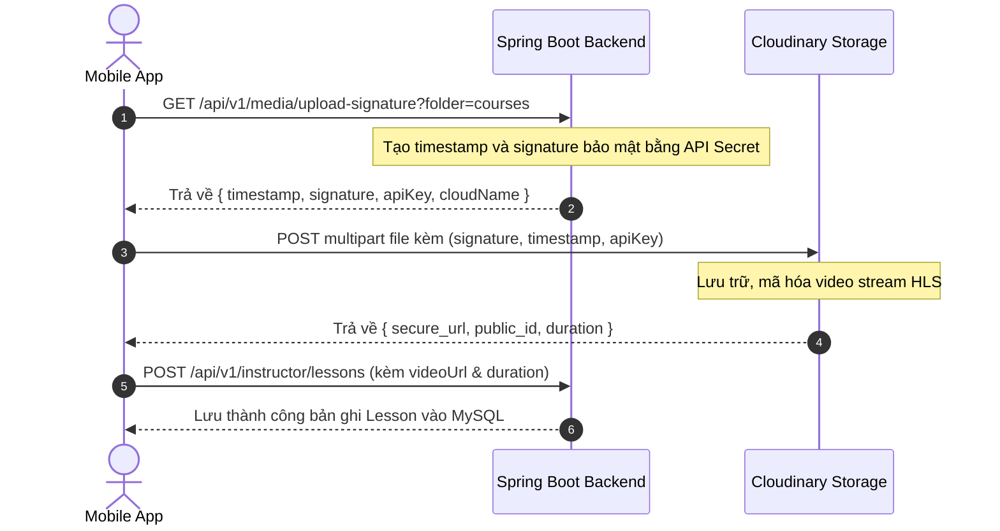

# Quy ước Thiết kế API Chuẩn (API Conventions) - Edumy Platform

> **Mã công việc:** W7-T1  
> **Áp dụng cho:** Toàn bộ thành viên phát triển Backend (Spring Boot 3) và Mobile (React Native / Axios)  
> **Mục tiêu:** Đồng bộ 100% hợp đồng dữ liệu, ngăn ngừa lỗi không tương thích giữa các module và giao diện.

---

## 1. Nguyên tắc Thiết kế RESTful Cơ bản

1. **Giao thức:** Bắt buộc sử dụng `HTTPS` trong mọi môi trường (ngoại trừ máy ảo cục bộ khi test localhost/Docker).
2. **Tiền tố đường dẫn (Base URI):**  
   `/api/v1/{module-resources}`
3. **Quy tắc đặt tên URL:**
   - Sử dụng **danh từ số nhiều**, chữ thường, ngăn cách bằng dấu gạch ngang (`kebab-case`).
   - Ví dụ chuẩn: `/api/v1/courses`, `/api/v1/course-categories`, `/api/v1/lesson-progress`.
   - Tuyệt đối không dùng động từ trong URL (ví dụ: SAI: `/api/v1/getCourseList` $\rightarrow$ ĐÚNG: `GET /api/v1/courses`).
4. **Phương thức HTTP (HTTP Verbs):**
   - `GET`: Lấy thông tin tài nguyên (Idempotent, không làm thay đổi trạng thái hệ thống).
   - `POST`: Tạo mới tài nguyên hoặc kích hoạt tác vụ đặc thù (Checkout, Submit review).
   - `PUT`: Cập nhật toàn bộ tài nguyên (Idempotent).
   - `PATCH`: Cập nhật một phần thuộc tính tài nguyên (ví dụ: đổi mật khẩu, cập nhật tiến độ xem).
   - `DELETE`: Xóa tài nguyên (Idempotent).
5. **Định dạng dữ liệu:**
   - Body gửi lên và Body trả về luôn là `application/json; charset=utf-8`.
   - Tên trường trong JSON luôn viết theo kiểu **`camelCase`** (`fullName`, `thumbnailUrl`, `createdAt`).

---

## 2. Chuẩn hóa Định dạng Phản hồi (API Response Contract)

Mọi API của hệ thống Edumy (thành công lẫn thất bại) đều phải trả về theo một khung đối tượng duy nhất là `ApiResponse<T>`.

### 2.1. Phản hồi Thành công (Success Response)
Áp dụng cho các mã trạng thái `200 OK`, `201 CREATED`:

```json
{
  "success": true,
  "message": "Mô tả kết quả thực thi thành công",
  "data": {
    "id": 1,
    "title": "Lập trình React Native thực chiến",
    "price": 499000.00
  }
}
```

*Trường hợp không có dữ liệu trả về (chỉ cần xác nhận thành công):*
```json
{
  "success": true,
  "message": "Đã xóa khóa học khỏi danh sách yêu thích",
  "data": null
}
```

### 2.2. Phản hồi Phân trang Chuẩn (Pagination Response)
Áp dụng cho các danh sách có thể phình to (Courses, Reviews, Users, Q&A).  
*Tham số truy vấn (Query Params):*
- `page`: Số thứ tự trang (0-indexed, mặc định: `0`).
- `size`: Số phần tử trên mỗi trang (mặc định: `10`, tối đa: `50`).
- `sort`: Tiêu chí sắp xếp, định dạng `<field>,<asc|desc>` (mặc định: `createdAt,desc`).

*Cấu trúc JSON trả về:*
```json
{
  "success": true,
  "message": "Lấy danh sách khóa học thành công",
  "data": {
    "content": [
      {
        "id": 10,
        "title": "Spring Boot 3.4 Microservices",
        "price": 599000.00,
        "rating": 4.8
      }
    ],
    "page": 0,
    "size": 10,
    "totalElements": 48,
    "totalPages": 5,
    "last": false
  }
}
```

### 2.3. Phản hồi Lỗi Chuẩn (Error Response)
Áp dụng khi xảy ra lỗi nghiệp vụ, lỗi thẩm định (Validation), lỗi phân quyền hoặc lỗi hệ thống:

```json
{
  "success": false,
  "message": "Dữ liệu gửi lên không hợp lệ",
  "data": null,
  "errors": [
    {
      "field": "email",
      "message": "Email đã được sử dụng trong hệ thống"
    },
    {
      "field": "password",
      "message": "Mật khẩu phải có độ dài từ 6 đến 32 ký tự"
    }
  ]
}
```

---

## 3. Mã Trạng Thái HTTP & Mã Lỗi Nghiệp Vụ

| HTTP Status | Trường hợp sử dụng | Mô tả & Hướng xử lý phía Mobile |
| :---: | :--- | :--- |
| **200 OK** | Thành công cho các thao tác `GET`, `PUT`, `PATCH`. | Nhận dữ liệu hiển thị lên UI. |
| **201 CREATED** | Thành công cho thao tác `POST` tạo mới tài nguyên. | Nhận dữ liệu mới tạo, chuyển màn hình hoặc làm mới danh sách. |
| **204 NO CONTENT** | Xóa thành công hoặc không cần trả về body. | Cập nhật UI ngay lập tức. |
| **400 BAD REQUEST** | Lỗi validate tham số đầu vào (`@Valid` vi phạm). | Hiển thị thông báo lỗi tương ứng dưới từng ô Input. |
| **401 UNAUTHORIZED** | Thiếu JWT Token, Token hết hạn hoặc sai chữ ký. | Mobile Interceptor kích hoạt refresh token; nếu thất bại $\rightarrow$ Đăng xuất về Login. |
| **403 FORBIDDEN** | Token hợp lệ nhưng không đủ quyền hạn (Role không khớp). | Hiển thị Dialog "Bạn không có quyền truy cập chức năng này". |
| **404 NOT FOUND** | Không tìm thấy tài nguyên theo ID hoặc Slug. | Chuyển sang màn hình Empty / 404 Not Found. |
| **409 CONFLICT** | Xung đột dữ liệu (Email đã tồn tại, đã ghi danh khóa học này rồi). | Hiển thị thông báo cảnh báo lỗi xung đột cho người dùng. |
| **422 UNPROCESSABLE** | Lỗi vi phạm quy tắc nghiệp vụ (ví dụ: Khóa học chưa đủ 1 bài học không được gửi duyệt). | Hiển thị SnackBar thông báo lý do vi phạm. |
| **500 INTERNAL ERROR** | Lỗi máy chủ không mong muốn (NPE, DB crash). | Hiển thị màn hình lỗi hệ thống kèm nút "Thử lại". |

---

## 4. Xác thực & Cơ chế Bảo mật JWT

1. **Header Xác thực:**  
   Mọi API yêu cầu đăng nhập phải truyền kèm HTTP Header:
   ```http
   Authorization: Bearer <jwt_access_token>
   ```
2. **Thời hạn Token (Token Lifespan):**
   - `Access Token`: Có hiệu lực trong **60 phút**. Chứa thông tin payload tối giản: `{ "sub": "userId", "email": "...", "role": "STUDENT" }`.
   - `Refresh Token`: Có hiệu lực trong **7 ngày**, lưu an toàn trong SecureStore (Mobile) và bảng token (hoặc lưu DB) để cấp lại Access Token mới.
3. **Luồng Cấp lại Token (Silent Refresh Flow):**
   - Mobile cài đặt Axios Response Interceptor bắt mã lỗi `401 Unauthorized`.
   - Tự động gọi API `POST /api/v1/auth/refresh-token` kèm `refreshToken`.
   - Nếu thành công: Cập nhật `accessToken` mới và gửi lại request ban đầu một cách tự động (người dùng không bị văng ra ngoài).
   - Nếu thất bại: Xóa toàn bộ token trong máy và điều hướng về trang Đăng nhập.

---

## 5. Quy chuẩn Định dạng Thời gian & Tiền tệ

1. **Thời gian (Date & Time):**  
   - Luôn sử dụng chuẩn **ISO-8601 UTC** kết thúc bằng ký tự `Z`:  
     `2026-10-27T08:30:00Z`
   - Phía Mobile chịu trách nhiệm chuyển đổi sang múi giờ người dùng địa phương (GMT+7) khi hiển thị.
2. **Tiền tệ (Currency):**  
   - Backend lưu trữ dạng `BigDecimal` (DECIMAL 12,2 trong MySQL).
   - JSON trả về kiểu số thực (Number), ví dụ: `499000.00`.
   - Mobile định dạng hiển thị kèm ký hiệu tiền tệ Việt Nam: `499.000 ₫`.

---

## 6. Quy trình Tải Lên Video & Hình ảnh (Cloudinary Upload Contract)

Để giảm tải tối đa cho Backend Spring Boot, hệ thống áp dụng cơ chế **Direct Client-to-Cloudinary Signed Upload**:



---

## 7. Hợp đồng 3 Trạng thái Giao diện Mobile (3 UI States Contract)

Khi xây dựng màn hình, mỗi thành viên bắt buộc phải xử lý đủ 3 trạng thái giao diện tương ứng với mã API:

```text
┌─────────────────────────────────────────────────────────────┐
│                       3 UI STATES CONTRACT                  │
├─────────────────────┬───────────────────────────────────────┤
│ 1. Loading State    │ Khi axios đang fetch (isLoading = true)│
│                     │ -> Hiển thị Skeleton hoặc Spinner    │
├─────────────────────┼───────────────────────────────────────┤
│ 2. Empty Data State │ Khi API trả về mảng rỗng []           │
│                     │ -> Icon minh họa + Nút CTA hành động  │
├─────────────────────┼───────────────────────────────────────┤
│ 3. Error State      │ Khi API trả mã >= 400 hoặc Timeout    │
│                     │ -> Banner cảnh báo + Nút Thử lại (Retry)│
└─────────────────────┴───────────────────────────────────────┘
```

---

## 8. Danh mục Endpoints Cốt lõi (Core Endpoints Matrix)

### Module A: Auth & Profile
- `POST /api/v1/auth/register` - Đăng ký tài khoản mới.
- `POST /api/v1/auth/login` - Đăng nhập, nhận cặp JWT token.
- `POST /api/v1/auth/refresh-token` - Làm mới access token.
- `GET /api/v1/users/me` - Lấy thông tin tài khoản hiện tại.
- `PUT /api/v1/users/me` - Cập nhật họ tên, bio, avatar.
- `PATCH /api/v1/users/me/password` - Đổi mật khẩu.

### Module B: Catalog & Discovery
- `GET /api/v1/categories` - Lấy danh sách danh mục khóa học.
- `GET /api/v1/courses` - Tìm kiếm, lọc và phân trang khóa học (`keyword`, `categoryId`, `level`, `priceType`, `page`, `size`, `sort`).
- `GET /api/v1/courses/{id}` - Chi tiết khóa học (kèm curriculum tóm tắt).
- `GET /api/v1/courses/{id}/reviews` - Lấy danh sách đánh giá của khóa học.
- `POST /api/v1/courses/{id}/reviews` - Viết đánh giá (yêu cầu role Student đã enroll).
- `GET /api/v1/wishlists` - Lấy danh sách khóa học yêu thích của tôi.
- `POST /api/v1/wishlists/{courseId}` - Thêm vào danh sách yêu thích.
- `DELETE /api/v1/wishlists/{courseId}` - Xóa khỏi danh sách yêu thích.

### Module C: Instructor Studio
- `GET /api/v1/instructor/courses` - Danh sách khóa học do giảng viên tạo (`status`).
- `POST /api/v1/instructor/courses` - Tạo mới khóa học (Bản nháp `DRAFT`).
- `PUT /api/v1/instructor/courses/{id}` - Cập nhật thông tin cơ bản khóa học.
- `POST /api/v1/instructor/courses/{id}/sections` - Thêm chương học mới.
- `POST /api/v1/instructor/sections/{sectionId}/lessons` - Thêm bài học kèm video Cloudinary.
- `PUT /api/v1/instructor/lessons/{lessonId}` - Chỉnh sửa thông tin bài học.
- `DELETE /api/v1/instructor/lessons/{lessonId}` - Xóa bài học.
- `PATCH /api/v1/instructor/courses/{id}/submit` - Gửi khóa học vào hàng chờ duyệt (`PENDING`).

### Module D: Orders, Learning & Certificate
- `POST /api/v1/orders/checkout` - Tạo đơn hàng và thanh toán (Hỗ trợ phương thức `MOCK` và `VNPAY`).
- `GET /api/v1/enrollments/my-learning` - Lấy danh sách khóa học đang học của học viên.
- `GET /api/v1/enrollments/{courseId}/curriculum` - Lấy toàn bộ bài học video sau khi đã mua.
- `PATCH /api/v1/lessons/{lessonId}/progress` - Cập nhật thời gian đã xem và đánh dấu hoàn thành bài học.
- `GET /api/v1/enrollments/{enrollmentId}/certificate` - Lấy thông tin chứng chỉ và tải file PDF.

### Module E: Admin & Community
- `GET /api/v1/admin/dashboard/stats` - Số liệu thống kê tổng thể hệ thống.
- `GET /api/v1/admin/courses/review-queue` - Danh sách khóa học đang chờ duyệt.
- `PATCH /api/v1/admin/courses/{id}/approve` - Phê duyệt khóa học (`PUBLISHED`).
- `PATCH /api/v1/admin/courses/{id}/reject` - Từ chối khóa học kèm lý do (`REJECTED`).
- `GET /api/v1/admin/users` - Danh sách người dùng hệ thống.
- `PATCH /api/v1/admin/users/{id}/lock` - Khóa/Mở khóa tài khoản người dùng.
- `POST /api/v1/admin/categories` - Tạo mới danh mục.
- `GET /api/v1/lessons/{lessonId}/questions` - Danh sách câu hỏi thảo luận theo bài học.
- `POST /api/v1/lessons/{lessonId}/questions` - Đặt câu hỏi mới.
- `POST /api/v1/questions/{questionId}/answers` - Trả lời câu hỏi.
- `PATCH /api/v1/answers/{answerId}/accept` - Giảng viên xác nhận câu trả lời đúng/hữu ích.
- `GET /api/v1/notifications` - Danh sách thông báo của người dùng.
