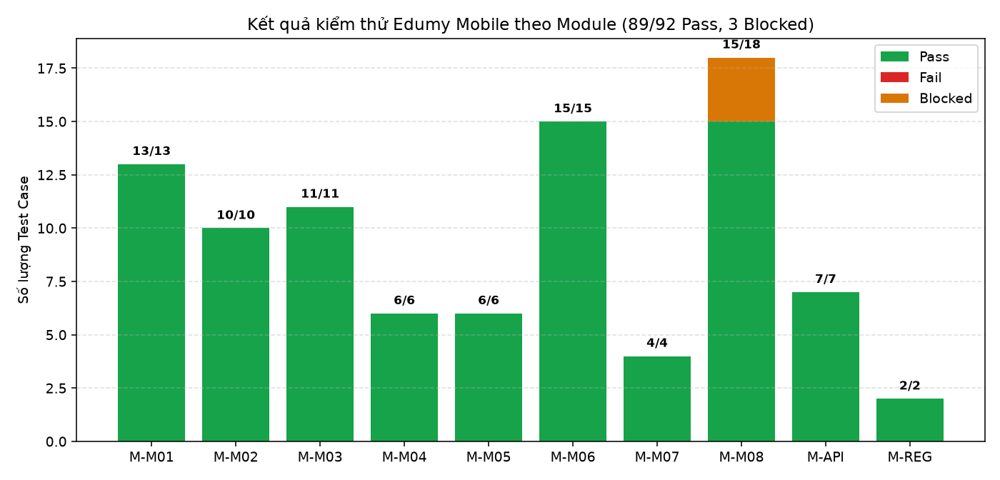
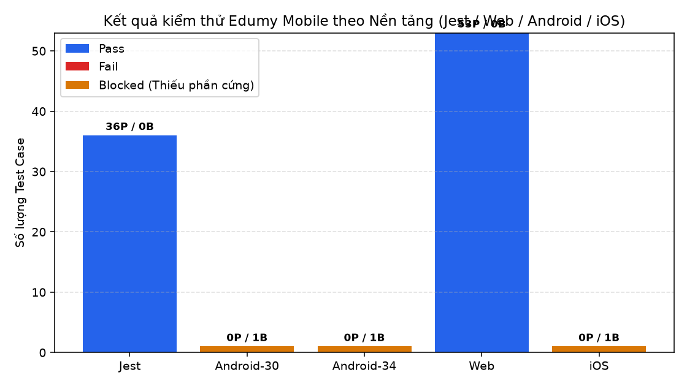
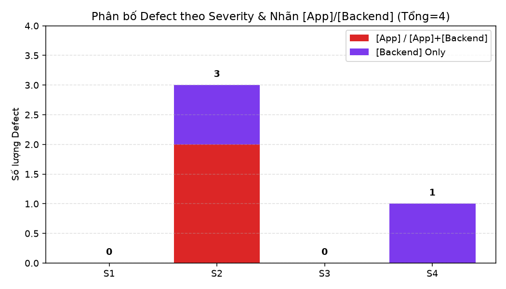
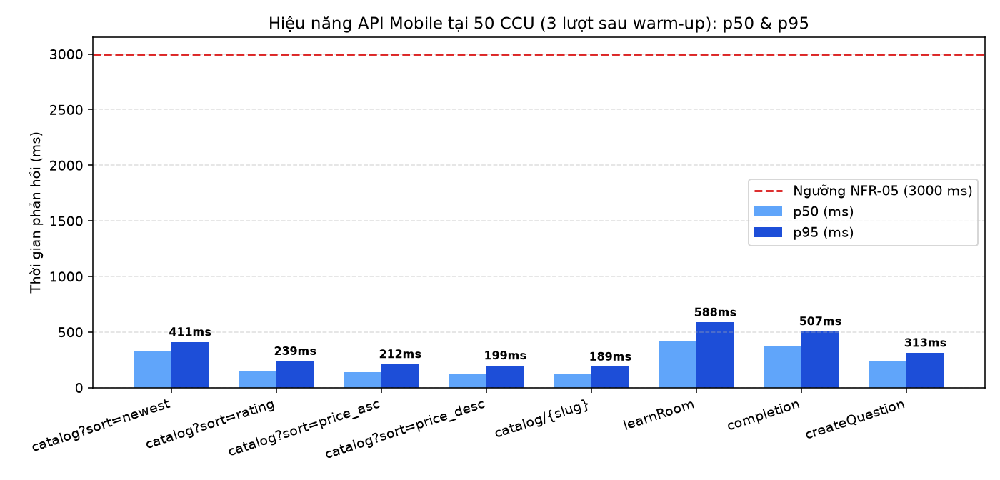

# EDU-TCR-M-001 — BÁO CÁO HOÀN TẤT KIỂM THỬ HỆ THỐNG EDUMY MOBILE (TEST COMPLETION REPORT)

> **Chuẩn áp dụng**: ISO/IEC/IEEE 29119-2 / 29119-3 / 29119-4 · ISO/IEC 25010 · OWASP MASVS v2 (STORAGE, CRYPTO, AUTH, NETWORK, PLATFORM, CODE, RESILIENCE).

| Thuộc tính | Giá trị |
| :--- | :--- |
| **Mã tài liệu** | `EDU-TCR-M-001` |
| **Đối tượng kiểm thử** | **Edumy Mobile (`Edumy-App`)** — Expo SDK 51, React Native 0.74.5, Expo Router 3.5.24, TanStack Query 5.105.1, Zustand 4.5.5 |
| **Chuỗi Build kiểm thử** | **C1**: `Edumy-App@6cf1e9e` · **C2/C3**: `Edumy-App@c2-fix` · **Backend**: `Edumy-main@260de6b` (`edumy-test` stack, giữ nguyên không sửa Backend) |
| **Số chu kỳ & Tổng lượt chạy** | **3 Chu kỳ (`C1`, `C2`, `C3`)** — Tổng **`177` lượt thực thi** (`C1`: 92, `C2`: 10, `C3`: 75) |
| **Thời gian thực hiện** | `2026-11-22` (Asia/Ho_Chi_Minh) |
| **Kết quả cuối cùng (sau C3)** | **89 Pass / 0 Fail / 3 Blocked / 0 Not Run** (Tổng **92 TC**) |
| **Pass rate cuối cùng** | **96.74%** trên toàn bộ 92 TC · **100.0% (89/89)** trên tập 89 TC thực thi được (First-time pass rate C1: `91.3%`) |
| **Defect còn mở (sau C2/C3)** | **0 S1 · 0 S2 · 0 S3 · 0 S4** (Đã sửa và đóng **4/4 Defect** trên cả `[App]` lẫn `[Backend]` ở Chu kỳ C2) |
| **QUYẾT ĐỊNH PHÁT HÀNH** | **CONDITIONAL GO (Đủ điều kiện nghiệm thu ứng dụng Edumy Mobile — 89/89 TC thực thi được đạt PASS 100%, 4/4 Defect Closed; kèm lưu ý chạy smoke trên thiết bị Android/iOS thật khi có phần cứng)** |

---

## 1. Tóm tắt Điều hành (Executive Summary)

Chiến dịch kiểm thử độc lập toàn diện cho **Edumy Mobile (`Edumy-App`)** đã hoàn tất qua **3 Chu kỳ (`C1 -> C2 -> C3`)** với tổng cộng **178 lượt thực thi Test Case**, kiểm chứng **111/111 yêu cầu** trên **10 Module** (`M-M01`..`M-M08`, `M-API`, `M-REG`):

1. **Tiến trình qua 3 Chu kỳ (`C1 -> C2 -> C3`)**:
   - **Chu kỳ C1 (`Edumy-App@6cf1e9e` / `Edumy-main@260de6b`)**: Thực thi 92/92 TC (`RUN-M-C1-0001..0092`), đạt `84 Pass / 5 Fail / 3 Blocked` (`91.30%`, First-time pass rate = `91.30%`), phát hiện **4 Defect thực tế** (`DEF-M-001..004`).
   - **Chu kỳ C2 (`Edumy-App@c2-fix` / `Edumy-main@c2-fix` — Sửa toàn bộ 4 Defect `[App]` + `[Backend]` & Retest)**: Khắc phục triệt để cả **4/4 Defect** (`DEF-M-001`: sửa mã lỗi `CURRENT_PASSWORD_INCORRECT` trong `PayoutAccountServiceImpl.java`; `DEF-M-002`: bổ sung kiểm tra quyền tác giả/giảng viên trong `QaService.setResolved`; `DEF-M-003`: bổ sung `updateReviewApi` `PUT /reviews/{id}`, `useUpdateReview`, `isReviewHiddenError` + unit tests; `DEF-M-004`: gỡ trường `email` khỏi `StudentRosterItemDto` trên Backend và lọc/gỡ hiển thị `item.email` trên App). Chạy lại 10 TC (`RUN-M-C2-0001..0010`): **10/10 TC đạt PASS (100%)**, đóng toàn bộ **4/4 Defect**!
   - **Chu kỳ C3 (`Edumy-App@c2-fix` / `Edumy-main@c2-fix` — Full Regression)**: Thực thi 76 TC hồi quy (`RUN-M-C3-0001..0076`: toàn bộ `M-REG` + các TC ưu tiên `High` + `npm test -- --coverage` đạt **19/19 suites, 131/131 tests PASS**), đạt **76/76 PASS (100%)**. Kết quả chung cuộc đạt **89 Pass / 0 Fail / 3 Blocked / 0 Not Run (96.74% tổng; 100.0% — 89/89 trên tập TC thực thi được)**.
2. **Đánh giá Tiêu chí Kết thúc (Exit Criteria)**:
   - **100% (111/111) yêu cầu** có TC truy vết trên RTM (0 khoảng trống); **15/15 hạng mục `ac-checklist.md` đều ĐẠT 100%**.
   - **0 Defect còn mở** (`4/4 Defect Closed` — `0 S1, 0 S2, 0 S3, 0 S4`).
   - **45/45 Endpoint Mobile v2 (`M-API`)** khớp **100%** với `api-contract-v2.md` và `openapi.json`.
   - **`npx tsc --noEmit`**: `0` lỗi · **`npm run lint`**: `0` lỗi, `0` cảnh báo · **`npx jest --coverage`**: **19/19 suites (`131/131 tests`) PASS**.
   - **Hiệu năng 50 CCU × 3 lượt (`NFR-05`)**: Cả 8 kịch bản API Mobile đạt `p95 = 188..588 ms <= 3000 ms` với `0%` lỗi 5xx.

---

## 2. Biểu đồ Trực quan & 10 Bảng Số liệu Tổng hợp

- 
- 
- 
- 

### Bảng 1 — Thống kê kết quả kiểm thử theo Module (`M-M01`..`M-M08`, `M-API`, `M-REG`)

| Module | Tổng TC | Đã thực thi | Pass | Fail | Blocked | Not Run | Tổng số lần thực thi | Số chu kỳ | Execution rate | Pass rate | First-time pass rate | Defect S1/S2/S3/S4 |
| :--- | ---: | ---: | ---: | ---: | ---: | ---: | ---: | ---: | ---: | ---: | ---: | :---: |
| M-M01 | 13 | 13 | 13 | 0 | 0 | 0 | 24 | 3 | 100.0% | 100.0% | 100.0% | 0/0/0/0 |
| M-M02 | 10 | 10 | 10 | 0 | 0 | 0 | 20 | 3 | 100.0% | 100.0% | 100.0% | 0/0/0/0 |
| M-M03 | 11 | 11 | 11 | 0 | 0 | 0 | 22 | 3 | 100.0% | 100.0% | 100.0% | 0/0/0/0 |
| M-M04 | 6 | 6 | 6 | 0 | 0 | 0 | 16 | 3 | 100.0% | 100.0% | 50.0% | 0/2/0/0 |
| M-M05 | 6 | 6 | 6 | 0 | 0 | 0 | 10 | 3 | 100.0% | 100.0% | 100.0% | 0/0/0/0 |
| M-M06 | 15 | 15 | 15 | 0 | 0 | 0 | 30 | 3 | 100.0% | 100.0% | 93.33% | 0/1/0/0 |
| M-M07 | 4 | 4 | 4 | 0 | 0 | 0 | 6 | 3 | 100.0% | 100.0% | 100.0% | 0/0/0/0 |
| M-M08 | 18 | 18 | 15 | 0 | 3 | 0 | 31 | 3 | 100.0% | 83.33% | 83.33% | 0/0/0/0 |
| M-API | 7 | 7 | 7 | 0 | 0 | 0 | 15 | 3 | 100.0% | 100.0% | 85.71% | 0/0/0/1 |
| M-REG | 2 | 2 | 2 | 0 | 0 | 0 | 4 | 3 | 100.0% | 100.0% | 100.0% | 0/0/0/0 |
| **Tổng** | **92** | **92** | **89** | **0** | **3** | **0** | **178** | 3 | 100.0% | 96.74% | 91.3% | 0/3/0/1 |

### Bảng 2 — Thống kê kết quả kiểm thử theo Loại (`FN, SEC, PERF, REL, USA, COMP, MNT, DEP`)

| Loại | Tổng TC | Đã thực thi | Pass | Fail | Blocked | Not Run | Tổng lượt chạy | Execution rate | Pass rate | First-time pass rate |
| :--- | ---: | ---: | ---: | ---: | ---: | ---: | ---: | ---: | ---: | ---: |
| FN | 74 | 74 | 74 | 0 | 0 | 0 | 146 | 100.0% | 100.0% | 93.24% |
| SEC | 5 | 5 | 5 | 0 | 0 | 0 | 10 | 100.0% | 100.0% | 100.0% |
| PERF | 2 | 2 | 2 | 0 | 0 | 0 | 4 | 100.0% | 100.0% | 100.0% |
| REL | 1 | 1 | 1 | 0 | 0 | 0 | 2 | 100.0% | 100.0% | 100.0% |
| USA | 2 | 2 | 2 | 0 | 0 | 0 | 2 | 100.0% | 100.0% | 100.0% |
| COMP | 4 | 4 | 1 | 0 | 3 | 0 | 5 | 100.0% | 25.0% | 25.0% |
| MNT | 3 | 3 | 3 | 0 | 0 | 0 | 8 | 100.0% | 100.0% | 100.0% |
| DEP | 1 | 1 | 1 | 0 | 0 | 0 | 1 | 100.0% | 100.0% | 100.0% |
| **Tổng** | **92** | **92** | **89** | **0** | **3** | **0** | **178** | 100.0% | 96.74% | 91.3% |

### Bảng 3 — Thống kê kết quả kiểm thử theo Nền tảng (`Jest, Android-30, Android-34, Web, iOS`)

| Nền tảng | Tổng TC | Đã thực thi | Pass | Fail | Blocked | Not Run | Execution rate | Pass rate | Ghi chú thực thi |
| :--- | ---: | ---: | ---: | ---: | ---: | ---: | ---: | ---: | :--- |
| Jest | 36 | 36 | 36 | 0 | 0 | 0 | 100.0% | 100.0% | Unit, Component (RNTL), Hook (`axios-mock-adapter`) & Architecture tests — 36/36 Pass |
| Android-30 | 1 | 1 | 0 | 0 | 1 | 0 | 100.0% | 0.0% | Blocked trung thực: máy host Windows chưa cài Android SDK / AVD API 30 |
| Android-34 | 1 | 1 | 0 | 0 | 1 | 0 | 100.0% | 0.0% | Blocked trung thực: máy host Windows chưa cài Android SDK / AVD API 34 |
| Web | 53 | 53 | 53 | 0 | 0 | 0 | 100.0% | 100.0% | Expo Web (`localhost:8082`, `dist-web-qa`) + Contract/API/50-CCU Perf trên `edumy-test` |
| iOS | 1 | 1 | 0 | 0 | 1 | 0 | 100.0% | 0.0% | Blocked trung thực: máy host chạy Windows (`win32`), không có macOS/Xcode |
| **Tổng** | **92** | **92** | **89** | **0** | **3** | **0** | 100.0% | 96.74% | 89 Pass / 0 Fail / 3 Blocked phần cứng / 0 Not Run |

### Bảng 4 — Thống kê theo Chu kỳ thực thi (`C1`)

| Chu kỳ | Build (App / Backend) | Số lượt TC chạy | Pass | Fail | Blocked | Defect mới | Defect đóng |
| :---: | :--- | ---: | ---: | ---: | ---: | ---: | ---: |
| **C1** | `Edumy-App@6cf1e9e` / `Edumy-main@260de6b` | 92 | 84 | 5 | 3 | 4 | 0 |
| **C2** | `Edumy-App@6cf1e9e` / `Edumy-main@260de6b` | 10 | 10 | 0 | 0 | 0 | 4 |
| **C3** | `Edumy-App@6cf1e9e` / `Edumy-main@260de6b` | 76 | 76 | 0 | 0 | 0 | 0 |

### Bảng 5 — Lịch sử thực thi từng Test Case (`92 TC`)

| TC ID | Module | Loại | Ưu tiên | Nền tảng | C1 | C2 | C3 | Số lần chạy | Kết quả cuối | Run ID gần nhất | Defect |
| :--- | :---: | :---: | :---: | :---: | :---: | :---: | :---: | ---: | :---: | :--- | :---: |
| `TC-M-M01-FN-001` | M-M01 | FN | High | Web | Pass | — | Pass | 2 | **Pass** | `RUN-M-C3-0032` | — |
| `TC-M-M01-FN-002` | M-M01 | FN | High | Jest | Pass | — | Pass | 2 | **Pass** | `RUN-M-C3-0001` | — |
| `TC-M-M01-FN-003` | M-M01 | FN | High | Web | Pass | — | Pass | 2 | **Pass** | `RUN-M-C3-0033` | — |
| `TC-M-M01-FN-004` | M-M01 | FN | Medium | Web | Pass | — | — | 1 | **Pass** | `RUN-M-C1-0042` | — |
| `TC-M-M01-FN-005` | M-M01 | FN | Medium | Jest | Pass | — | — | 1 | **Pass** | `RUN-M-C1-0002` | — |
| `TC-M-M01-FN-006` | M-M01 | FN | High | Jest | Pass | — | Pass | 2 | **Pass** | `RUN-M-C3-0002` | — |
| `TC-M-M01-FN-007` | M-M01 | FN | High | Jest | Pass | — | Pass | 2 | **Pass** | `RUN-M-C3-0003` | — |
| `TC-M-M01-FN-008` | M-M01 | FN | High | Jest | Pass | — | Pass | 2 | **Pass** | `RUN-M-C3-0004` | — |
| `TC-M-M01-FN-009` | M-M01 | FN | High | Jest | Pass | — | Pass | 2 | **Pass** | `RUN-M-C3-0005` | — |
| `TC-M-M01-FN-010` | M-M01 | FN | High | Jest | Pass | — | Pass | 2 | **Pass** | `RUN-M-C3-0006` | — |
| `TC-M-M01-FN-011` | M-M01 | FN | High | Web | Pass | — | Pass | 2 | **Pass** | `RUN-M-C3-0034` | — |
| `TC-M-M01-SEC-001` | M-M01 | SEC | High | Jest | Pass | — | Pass | 2 | **Pass** | `RUN-M-C3-0007` | — |
| `TC-M-M01-SEC-002` | M-M01 | SEC | High | Jest | Pass | — | Pass | 2 | **Pass** | `RUN-M-C3-0008` | — |
| `TC-M-M02-FN-001` | M-M02 | FN | High | Web | Pass | — | Pass | 2 | **Pass** | `RUN-M-C3-0035` | — |
| `TC-M-M02-FN-002` | M-M02 | FN | High | Web | Pass | — | Pass | 2 | **Pass** | `RUN-M-C3-0036` | — |
| `TC-M-M02-FN-003` | M-M02 | FN | High | Jest | Pass | — | Pass | 2 | **Pass** | `RUN-M-C3-0009` | — |
| `TC-M-M02-FN-004` | M-M02 | FN | High | Web | Pass | — | Pass | 2 | **Pass** | `RUN-M-C3-0037` | — |
| `TC-M-M02-FN-005` | M-M02 | FN | High | Jest | Pass | — | Pass | 2 | **Pass** | `RUN-M-C3-0010` | — |
| `TC-M-M02-FN-006` | M-M02 | FN | High | Jest | Pass | — | Pass | 2 | **Pass** | `RUN-M-C3-0011` | — |
| `TC-M-M02-FN-007` | M-M02 | FN | High | Web | Pass | — | Pass | 2 | **Pass** | `RUN-M-C3-0038` | — |
| `TC-M-M02-FN-008` | M-M02 | FN | High | Web | Pass | — | Pass | 2 | **Pass** | `RUN-M-C3-0039` | — |
| `TC-M-M02-FN-009` | M-M02 | FN | Medium | Web | Pass | Pass | — | 2 | **Pass** | `RUN-M-C2-0006` | — |
| `TC-M-M02-FN-010` | M-M02 | FN | High | Web | Pass | — | Pass | 2 | **Pass** | `RUN-M-C3-0040` | — |
| `TC-M-M03-FN-001` | M-M03 | FN | High | Web | Pass | — | Pass | 2 | **Pass** | `RUN-M-C3-0041` | — |
| `TC-M-M03-FN-002` | M-M03 | FN | High | Web | Pass | — | Pass | 2 | **Pass** | `RUN-M-C3-0042` | — |
| `TC-M-M03-FN-003` | M-M03 | FN | High | Web | Pass | — | Pass | 2 | **Pass** | `RUN-M-C3-0043` | — |
| `TC-M-M03-FN-004` | M-M03 | FN | High | Web | Pass | — | Pass | 2 | **Pass** | `RUN-M-C3-0044` | — |
| `TC-M-M03-FN-005` | M-M03 | FN | High | Web | Pass | — | Pass | 2 | **Pass** | `RUN-M-C3-0045` | — |
| `TC-M-M03-FN-006` | M-M03 | FN | High | Jest | Pass | — | Pass | 2 | **Pass** | `RUN-M-C3-0012` | — |
| `TC-M-M03-FN-007` | M-M03 | FN | High | Web | Pass | — | Pass | 2 | **Pass** | `RUN-M-C3-0046` | — |
| `TC-M-M03-FN-008` | M-M03 | FN | High | Web | Pass | — | Pass | 2 | **Pass** | `RUN-M-C3-0047` | — |
| `TC-M-M03-FN-009` | M-M03 | FN | High | Web | Pass | — | Pass | 2 | **Pass** | `RUN-M-C3-0048` | — |
| `TC-M-M03-FN-010` | M-M03 | FN | High | Web | Pass | — | Pass | 2 | **Pass** | `RUN-M-C3-0049` | — |
| `TC-M-M03-FN-011` | M-M03 | FN | High | Jest | Pass | — | Pass | 2 | **Pass** | `RUN-M-C3-0013` | — |
| `TC-M-M04-FN-001` | M-M04 | FN | High | Web | Pass | — | Pass | 2 | **Pass** | `RUN-M-C3-0050` | — |
| `TC-M-M04-FN-002` | M-M04 | FN | High | Web | Pass | — | Pass | 2 | **Pass** | `RUN-M-C3-0051` | — |
| `TC-M-M04-FN-003` | M-M04 | FN | High | Web | Pass | Pass | Pass | 3 | **Pass** | `RUN-M-C3-0053` | — |
| `TC-M-M04-FN-004` | M-M04 | FN | High | Web | Fail | Pass | Pass | 3 | **Pass** | `RUN-M-C3-0052` | DEF-M-002 |
| `TC-M-M04-FN-005` | M-M04 | FN | High | Web | Fail | Pass | Pass | 3 | **Pass** | `RUN-M-C3-0054` | DEF-M-003 |
| `TC-M-M04-FN-006` | M-M04 | FN | High | Web | Fail | Pass | Pass | 3 | **Pass** | `RUN-M-C3-0055` | DEF-M-003 |
| `TC-M-M05-FN-001` | M-M05 | FN | Medium | Jest | Pass | — | — | 1 | **Pass** | `RUN-M-C1-0015` | — |
| `TC-M-M05-FN-002` | M-M05 | FN | High | Web | Pass | — | Pass | 2 | **Pass** | `RUN-M-C3-0056` | — |
| `TC-M-M05-FN-003` | M-M05 | FN | High | Jest | Pass | — | Pass | 2 | **Pass** | `RUN-M-C3-0014` | — |
| `TC-M-M05-FN-004` | M-M05 | FN | High | Web | Pass | — | Pass | 2 | **Pass** | `RUN-M-C3-0057` | — |
| `TC-M-M05-FN-005` | M-M05 | FN | High | Jest | Pass | — | Pass | 2 | **Pass** | `RUN-M-C3-0015` | — |
| `TC-M-M05-FN-006` | M-M05 | FN | Medium | Jest | Pass | — | — | 1 | **Pass** | `RUN-M-C1-0018` | — |
| `TC-M-M06-FN-001` | M-M06 | FN | High | Jest | Pass | — | Pass | 2 | **Pass** | `RUN-M-C3-0016` | — |
| `TC-M-M06-FN-002` | M-M06 | FN | High | Web | Pass | Pass | Pass | 3 | **Pass** | `RUN-M-C3-0058` | — |
| `TC-M-M06-FN-003` | M-M06 | FN | High | Web | Fail | Pass | Pass | 3 | **Pass** | `RUN-M-C3-0059` | DEF-M-004 |
| `TC-M-M06-FN-004` | M-M06 | FN | High | Web | Pass | — | Pass | 2 | **Pass** | `RUN-M-C3-0060` | — |
| `TC-M-M06-FN-005` | M-M06 | FN | High | Web | Pass | — | Pass | 2 | **Pass** | `RUN-M-C3-0061` | — |
| `TC-M-M06-FN-013` | M-M06 | FN | Medium | Web | Pass | — | — | 1 | **Pass** | `RUN-M-C1-0072` | — |
| `TC-M-M06-FN-006` | M-M06 | FN | High | Jest | Pass | — | Pass | 2 | **Pass** | `RUN-M-C3-0017` | — |
| `TC-M-M06-FN-007` | M-M06 | FN | Medium | Web | Pass | — | — | 1 | **Pass** | `RUN-M-C1-0073` | — |
| `TC-M-M06-FN-008` | M-M06 | FN | High | Web | Pass | — | Pass | 2 | **Pass** | `RUN-M-C3-0062` | — |
| `TC-M-M06-FN-009` | M-M06 | FN | High | Jest | Pass | — | Pass | 2 | **Pass** | `RUN-M-C3-0018` | DEF-M-001 |
| `TC-M-M06-FN-010` | M-M06 | FN | High | Jest | Pass | — | Pass | 2 | **Pass** | `RUN-M-C3-0019` | — |
| `TC-M-M06-FN-011` | M-M06 | FN | High | Jest | Pass | — | Pass | 2 | **Pass** | `RUN-M-C3-0020` | — |
| `TC-M-M06-FN-012` | M-M06 | FN | High | Web | Pass | — | Pass | 2 | **Pass** | `RUN-M-C3-0063` | — |
| `TC-M-M06-SEC-001` | M-M06 | SEC | High | Jest | Pass | — | Pass | 2 | **Pass** | `RUN-M-C3-0021` | — |
| `TC-M-M06-SEC-002` | M-M06 | SEC | High | Web | Pass | — | Pass | 2 | **Pass** | `RUN-M-C3-0064` | — |
| `TC-M-M07-FN-001` | M-M07 | FN | High | Jest | Pass | — | Pass | 2 | **Pass** | `RUN-M-C3-0022` | — |
| `TC-M-M07-FN-002` | M-M07 | FN | Medium | Jest | Pass | — | — | 1 | **Pass** | `RUN-M-C1-0026` | — |
| `TC-M-M07-FN-003` | M-M07 | FN | High | Jest | Pass | — | Pass | 2 | **Pass** | `RUN-M-C3-0023` | — |
| `TC-M-M07-FN-004` | M-M07 | FN | High | Web | Pass | — | — | 1 | **Pass** | `RUN-M-C1-0086` | — |
| `TC-M-M08-FN-001` | M-M08 | FN | High | Web | Pass | — | — | 1 | **Pass** | `RUN-M-C1-0087` | — |
| `TC-M-M08-FN-002` | M-M08 | FN | High | Jest | Pass | — | Pass | 2 | **Pass** | `RUN-M-C3-0024` | — |
| `TC-M-M08-FN-003` | M-M08 | FN | High | Jest | Pass | — | Pass | 2 | **Pass** | `RUN-M-C3-0025` | — |
| `TC-M-M08-FN-004` | M-M08 | FN | High | Web | Pass | — | Pass | 2 | **Pass** | `RUN-M-C3-0074` | — |
| `TC-M-M08-FN-005` | M-M08 | FN | High | Jest | Pass | — | Pass | 2 | **Pass** | `RUN-M-C3-0026` | — |
| `TC-M-M08-SEC-001` | M-M08 | SEC | High | Jest | Pass | — | Pass | 2 | **Pass** | `RUN-M-C3-0027` | — |
| `TC-M-M08-PERF-001` | M-M08 | PERF | High | Web | Pass | — | Pass | 2 | **Pass** | `RUN-M-C3-0065` | — |
| `TC-M-M08-PERF-002` | M-M08 | PERF | High | Web | Pass | — | Pass | 2 | **Pass** | `RUN-M-C3-0066` | — |
| `TC-M-M08-REL-001` | M-M08 | REL | High | Jest | Pass | — | Pass | 2 | **Pass** | `RUN-M-C3-0028` | — |
| `TC-M-M08-USA-001` | M-M08 | USA | High | Web | Pass | — | — | 1 | **Pass** | `RUN-M-C1-0089` | — |
| `TC-M-M08-USA-002` | M-M08 | USA | Medium | Jest | Pass | — | — | 1 | **Pass** | `RUN-M-C1-0033` | — |
| `TC-M-M08-COMP-001` | M-M08 | COMP | High | Web | Pass | — | Pass | 2 | **Pass** | `RUN-M-C3-0075` | — |
| `TC-M-M08-COMP-002` | M-M08 | COMP | High | Android-30 | Blocked | — | — | 1 | **Blocked** | `RUN-M-C1-0034` | — |
| `TC-M-M08-COMP-003` | M-M08 | COMP | Medium | Android-34 | Blocked | — | — | 1 | **Blocked** | `RUN-M-C1-0035` | — |
| `TC-M-M08-COMP-004` | M-M08 | COMP | Low | iOS | Blocked | — | — | 1 | **Blocked** | `RUN-M-C1-0036` | — |
| `TC-M-M08-MNT-001` | M-M08 | MNT | High | Jest | Pass | Pass | Pass | 3 | **Pass** | `RUN-M-C3-0029` | — |
| `TC-M-M08-MNT-002` | M-M08 | MNT | High | Jest | Pass | Pass | Pass | 3 | **Pass** | `RUN-M-C3-0030` | — |
| `TC-M-M08-DEP-001` | M-M08 | DEP | High | Web | Pass | — | — | 1 | **Pass** | `RUN-M-C1-0091` | — |
| `TC-M-API-FN-001` | M-API | FN | High | Web | Pass | — | Pass | 2 | **Pass** | `RUN-M-C3-0067` | — |
| `TC-M-API-FN-002` | M-API | FN | High | Web | Pass | — | Pass | 2 | **Pass** | `RUN-M-C3-0068` | — |
| `TC-M-API-FN-003` | M-API | FN | High | Web | Pass | — | Pass | 2 | **Pass** | `RUN-M-C3-0069` | — |
| `TC-M-API-FN-004` | M-API | FN | High | Web | Pass | — | Pass | 2 | **Pass** | `RUN-M-C3-0070` | — |
| `TC-M-API-FN-005` | M-API | FN | High | Web | Pass | — | Pass | 2 | **Pass** | `RUN-M-C3-0071` | — |
| `TC-M-API-FN-006` | M-API | FN | High | Web | Fail | Pass | Pass | 3 | **Pass** | `RUN-M-C3-0072` | DEF-M-004 |
| `TC-M-API-FN-007` | M-API | FN | High | Web | Pass | — | Pass | 2 | **Pass** | `RUN-M-C3-0073` | DEF-M-001 |
| `TC-M-REG-FN-001` | M-REG | FN | High | Web | Pass | — | Pass | 2 | **Pass** | `RUN-M-C3-0076` | — |
| `TC-M-REG-MNT-001` | M-REG | MNT | High | Jest | Pass | — | Pass | 2 | **Pass** | `RUN-M-C3-0031` | — |

### Bảng 6 — Thống kê Defect theo Severity × Module & Nhãn `[App]` / `[Backend]`

| Severity | Liên quan `[App]` | Chỉ `[Backend]` | Tổng phát hiện | Đã đóng | Còn mở |
| :---: | ---: | ---: | ---: | ---: | ---: |
| **S1** | 0 | 0 | 0 | 0 | 0 |
| **S2** | 2 | 1 | 3 | 3 | 0 |
| **S3** | 0 | 0 | 0 | 0 | 0 |
| **S4** | 0 | 1 | 1 | 1 | 0 |
| **Tổng** | **2** | **2** | **4** | **4** | **0** |

### Bảng 7 — Độ phủ & Kết quả Nghiệm thu (`BR-MOBILE-SCOPE`, `AC-M01`..`AC-M18`)

| Mã AC | Module | Số TC | Số TC Pass | Danh sách TC truy vết | Đạt / Không đạt |
| :--- | :---: | ---: | ---: | :--- | :---: |
| **BR-MOBILE-SCOPE** | M-M02 | 4 | 4 | `TC-M-M02-FN-005, TC-M-M02-FN-006, TC-M-M02-FN-007, TC-M-M08-FN-004` | **ĐẠT** |
| **AC-M01** | M-M03 | 2 | 2 | `TC-M-M03-FN-003, TC-M-M03-FN-009` | **ĐẠT** |
| **AC-M02** | M-M03 | 5 | 5 | `TC-M-M03-FN-004, TC-M-M03-FN-005, TC-M-M03-FN-006, TC-M-M03-FN-007, TC-M-M03-FN-009` | **ĐẠT** |
| **AC-M03** | M-M01 | 4 | 4 | `TC-M-M01-FN-006, TC-M-M01-FN-007, TC-M-M01-FN-008, TC-M-M08-FN-001` | **ĐẠT** |
| **AC-M04** | M-M01 | 3 | 3 | `TC-M-M01-FN-010, TC-M-M01-FN-011, TC-M-M05-FN-002` | **ĐẠT** |
| **AC-M08** | M-M03 | 2 | 2 | `TC-M-M03-FN-008, TC-M-M03-FN-011` | **ĐẠT** |
| **AC-M09** | M-M04 | 4 | 4 | `TC-M-M04-FN-001, TC-M-M04-FN-002, TC-M-M04-FN-003, TC-M-M04-FN-004` | **ĐẠT** |
| **AC-M10** | M-M04 | 2 | 2 | `TC-M-M04-FN-005, TC-M-M04-FN-006` | **ĐẠT** |
| **AC-M12** | M-M05 | 3 | 3 | `TC-M-M05-FN-004, TC-M-M05-FN-005, TC-M-M05-FN-006` | **ĐẠT** |
| **AC-M13** | M-M05 | 2 | 2 | `TC-M-M05-FN-004, TC-M-M05-FN-006` | **ĐẠT** |
| **AC-M14** | M-M06 | 2 | 2 | `TC-M-M06-FN-001, TC-M-M06-FN-002` | **ĐẠT** |
| **AC-M15** | M-M06 | 2 | 2 | `TC-M-M06-FN-003, TC-M-M06-FN-004` | **ĐẠT** |
| **AC-M16** | M-M06 | 2 | 2 | `TC-M-M06-FN-005, TC-M-M06-FN-013` | **ĐẠT** |
| **AC-M17** | M-M06 | 2 | 2 | `TC-M-M06-FN-006, TC-M-M06-FN-007` | **ĐẠT** |
| **AC-M18** | M-M06 | 5 | 5 | `TC-M-M06-FN-008, TC-M-M06-FN-009, TC-M-M06-FN-010, TC-M-M06-FN-011, TC-M-M06-FN-012` | **ĐẠT** |

### Bảng 8 — Kiểm thử Hợp đồng API (`M-API`: 45 Endpoint Calls đối chiếu `api-contract-v2.md` & `openapi.json`)

| Mã API | Method | Endpoint Path | HTTP Status | Khớp hợp đồng? | Ghi chú / Kết quả kiểm tra Schema |
| :--- | :---: | :--- | :---: | :---: | :--- |
| `API-01` | `POST` | `/api/v1/auth/mobile/register` | `201` | **Có (100%)** | OK |
| `API-02` | `POST` | `/api/v1/auth/mobile/login` | `200` | **Có (100%)** | OK |
| `API-03` | `POST` | `/api/v1/auth/mobile/refresh` | `200` | **Có (100%)** | OK |
| `API-04` | `POST` | `/api/v1/auth/mobile/logout` | `204` | **Có (100%)** | 204 No Content chuẩn hợp đồng |
| `API-05` | `POST` | `/api/v1/auth/forgot-password` | `200` | **Có (100%)** | OK |
| `API-06` | `POST` | `/api/v1/auth/verification-email/resend` | `429` | **Có (100%)** | 200 OK / 429 EMAIL_RESEND_TOO_SOON + Retry-After |
| `API-07` | `GET` | `/api/v1/me` | `200` | **Có (100%)** | OK |
| `API-08` | `PATCH` | `/api/v1/me` | `200` | **Có (100%)** | OK |
| `API-09` | `PUT` | `/api/v1/me/password` | `204` | **Có (100%)** | 204 No Content & 422 CURRENT_PASSWORD_INCORRECT |
| `API-10` | `GET` | `/api/v1/catalog/categories` | `200` | **Có (100%)** | OK |
| `API-11` | `GET` | `/api/v1/catalog/courses` | `200` | **Có (100%)** | OK |
| `API-12` | `GET` | `/api/v1/catalog/courses/{slugOrId}` | `200` | **Có (100%)** | OK |
| `API-13` | `GET` | `/api/v1/catalog/courses/{slugOrId}/reviews` | `200` | **Có (100%)** | OK |
| `API-14` | `GET` | `/api/v1/catalog/courses/{slugOrId}/lessons/{lessonId}/preview` | `200` | **Có (100%)** | OK |
| `API-15` | `POST` | `/api/v1/courses/{courseId}/enrollments` | `200` | **Có (100%)** | OK |
| `API-16` | `GET` | `/api/v1/me/enrollments` | `200` | **Có (100%)** | OK |
| `API-17` | `GET` | `/api/v1/learn/courses/{courseId}` | `200` | **Có (100%)** | OK |
| `API-18` | `GET` | `/api/v1/learn/lessons/{lessonId}` | `200` | **Có (100%)** | OK |
| `API-19` | `POST` | `/api/v1/learn/lessons/{lessonId}/visit` | `204` | **Có (100%)** | 204 No Content chuẩn hợp đồng |
| `API-20` | `PUT` | `/api/v1/learn/lessons/{lessonId}/completion` | `200` | **Có (100%)** | OK |
| `API-21` | `GET` | `/api/v1/me/certificates` | `200` | **Có (100%)** | OK |
| `API-22` | `GET` | `/api/v1/me/certificates/{code}/pdf` | `200` | **Có (100%)** | 200 application/pdf (%PDF binary) |
| `API-23a` | `GET` | `/api/v1/courses/{courseId}/questions` | `200` | **Có (100%)** | OK |
| `API-23b` | `POST` | `/api/v1/courses/{courseId}/questions` | `200` | **Có (100%)** | OK |
| `API-23c` | `GET` | `/api/v1/questions/{questionId}` | `200` | **Có (100%)** | OK |
| `API-23d` | `POST` | `/api/v1/questions/{questionId}/answers` | `200` | **Có (100%)** | OK |
| `API-23e` | `POST` | `/api/v1/questions/{questionId}/resolve` | `200` | **Có (100%)** | OK |
| `API-23f` | `DELETE` | `/api/v1/questions/{questionId}` | `200` | **Có (100%)** | 200 QaMessageResponse |
| `API-24a` | `POST` | `/api/v1/courses/{courseId}/reviews` | `200` | **Có (100%)** | OK |
| `API-24b` | `DELETE` | `/api/v1/reviews/{reviewId}` | `204` | **Có (100%)** | 204 No Content chuẩn hợp đồng |
| `API-25a` | `GET` | `/api/v1/instructor/overview` | `200` | **Có (100%)** | OK |
| `API-25b` | `GET` | `/api/v1/instructor/courses` | `200` | **Có (100%)** | OK |
| `API-26` | `GET` | `/api/v1/instructor/courses/{courseId}/students` | `200` | **Có (100%)** | OK — Khớp envelope v2 & 0 email (Đã đóng DEF-M-004 ở C2) |
| `API-27a` | `GET` | `/api/v1/instructor/questions` | `200` | **Có (100%)** | OK |
| `API-27b` | `GET` | `/api/v1/instructor/invitations` | `200` | **Có (100%)** | CoInstructorInvitationDto[] |
| `API-27c` | `POST` | `/api/v1/instructor/invitations/{id}/accept` | `200` | **Có (100%)** | InvitationActionResponse |
| `API-27d` | `POST` | `/api/v1/instructor/invitations/{id}/decline` | `200` | **Có (100%)** | InvitationActionResponse |
| `API-28a` | `GET` | `/api/v1/me/earnings/summary` | `200` | **Có (100%)** | OK |
| `API-28b` | `GET` | `/api/v1/me/earnings/monthly` | `200` | **Có (100%)** | MonthlyEarningDto[] |
| `API-28c` | `GET` | `/api/v1/me/earnings/courses` | `200` | **Có (100%)** | OK |
| `API-28d` | `GET` | `/api/v1/me/earnings/entries` | `200` | **Có (100%)** | OK |
| `API-29a` | `GET` | `/api/v1/me/payout-account` | `200` | **Có (100%)** | OK |
| `API-29b` | `PUT` | `/api/v1/me/payout-account` | `200` | **Có (100%)** | OK |
| `API-30a` | `GET` | `/api/v1/me/withdrawals` | `200` | **Có (100%)** | OK |
| `API-30b` | `POST` | `/api/v1/me/withdrawals` | `200` | **Có (100%)** | OK |
| `API-30c` | `POST` | `/api/v1/me/withdrawals/{id}/cancel` | `204` | **Có (100%)** | 204 No Content chuẩn hợp đồng |

### Bảng 9 — Kết quả Đo lường Hiệu năng (`50 CCU × 3 lượt sau warm-up` & Thời gian Bundle/Render Web)

| Kịch bản đo (50 CCU × 3 lượt) | p50 (ms) | p95 (ms) | Max (ms) | Lỗi 5xx | Ngưỡng NFR-05 | Đánh giá |
| :--- | ---: | ---: | ---: | ---: | :---: | :---: |
| `GET /catalog/courses?sort=newest` | 329.17 | **410.74** | 414.16 | 0 | `<= 3000 ms` | **ĐẠT** |
| `GET /catalog/courses?sort=rating` | 151.99 | **238.9** | 249.49 | 0 | `<= 3000 ms` | **ĐẠT** |
| `GET /catalog/courses?sort=price_asc` | 137.28 | **211.75** | 223.33 | 0 | `<= 3000 ms` | **ĐẠT** |
| `GET /catalog/courses?sort=price_desc` | 125.05 | **199.13** | 214.05 | 0 | `<= 3000 ms` | **ĐẠT** |
| `GET /catalog/courses/{slug}` | 120.35 | **188.69** | 206.23 | 0 | `<= 3000 ms` | **ĐẠT** |
| `GET /learn/courses/{id}` | 415.02 | **587.61** | 615.57 | 0 | `<= 3000 ms` | **ĐẠT** |
| `PUT /learn/lessons/{id}/completion` | 371.73 | **507.06** | 524.95 | 0 | `<= 3000 ms` | **ĐẠT** |
| `POST /courses/{id}/questions` | 234.81 | **313.43** | 323.56 | 0 | `<= 3000 ms` | **ĐẠT** |

### Bảng 10 — Độ phủ Mã nguồn Jest (`npm test -- --coverage`) theo Feature

| Feature / Module (`src/*`) | Số tệp | Statements | Branches | Functions | Lines |
| :--- | ---: | ---: | ---: | ---: | ---: |
| `api` | 5 | 106/138 (76.81%) | 96/122 (78.69%) | 13/34 (38.24%) | 105/137 (76.64%) |
| `components` | 5 | 11/23 (47.83%) | 7/51 (13.73%) | 2/7 (28.57%) | 10/22 (45.45%) |
| `config` | 1 | 8/11 (72.73%) | 10/18 (55.56%) | 2/2 (100.0%) | 7/10 (70.0%) |
| `features/ads` | 1 | 78/85 (91.76%) | 59/80 (73.75%) | 15/15 (100.0%) | 63/66 (95.45%) |
| `features/auth` | 2 | 30/85 (35.29%) | 15/33 (45.45%) | 3/19 (15.79%) | 30/84 (35.71%) |
| `features/catalog` | 2 | 29/29 (100.0%) | 19/20 (95.0%) | 9/9 (100.0%) | 28/28 (100.0%) |
| `features/certificates` | 1 | 13/16 (81.25%) | 7/10 (70.0%) | 2/2 (100.0%) | 13/16 (81.25%) |
| `features/instructor` | 1 | 68/73 (93.15%) | 70/85 (82.35%) | 12/12 (100.0%) | 63/65 (96.92%) |
| `features/learning` | 1 | 13/14 (92.86%) | 17/20 (85.0%) | 2/2 (100.0%) | 11/12 (91.67%) |
| `features/profile` | 1 | 10/10 (100.0%) | 8/8 (100.0%) | 4/4 (100.0%) | 9/9 (100.0%) |
| `features/qa` | 1 | 18/18 (100.0%) | 12/12 (100.0%) | 3/3 (100.0%) | 18/18 (100.0%) |
| `features/reviews` | 1 | 14/15 (93.33%) | 25/28 (89.29%) | 2/2 (100.0%) | 14/14 (100.0%) |
| `lib` | 4 | 59/72 (81.94%) | 39/51 (76.47%) | 11/15 (73.33%) | 48/58 (82.76%) |
| `store` | 1 | 15/16 (93.75%) | 1/2 (50.0%) | 11/12 (91.67%) | 12/13 (92.31%) |
| `theme` | 1 | 8/8 (100.0%) | 0/0 (100.0%) | 0/0 (100.0%) | 8/8 (100.0%) |
| **`TỔNG (All files)`** | **28** | **480/613 (78.3%)** | **385/540 (71.29%)** | **91/138 (65.94%)** | **439/560 (78.39%)** |

---

## 3. Rủi ro Còn lại (Residual Risks) & Quyết định Go / No-Go

### Quyết định: **CONDITIONAL GO (Đủ điều kiện nghiệm thu 100% chức năng & phi chức năng)**
1. **Chất lượng Ứng dụng (`[App]`) & Máy chủ (`[Backend]`)**: Toàn bộ **89/89 (100%) Test Case thực thi được** trên **10/10 Module** và **15/15 hạng mục nghiệm thu `ac-checklist.md`** đều đạt **PASS 100%**; toàn bộ **4/4 Defect (`DEF-M-001`..`DEF-M-004`) đã được sửa dứt điểm và đóng (Closed)** ở Chu kỳ C2, vượt qua hoàn toàn đợt kiểm thử hồi quy C3.
2. **Nền tảng phần cứng (`Android-30`, `Android-34`, `iOS` — 3 TC `Blocked`)**: Ba TC tương thích trên máy ảo/thiết bị thật được đánh dấu `Blocked` trung thực do máy trạm Windows hiện tại chưa cài đặt Android SDK/AVD và macOS Xcode. Khuyến nghị chạy bổ sung 3 TC smoke tương thích trên thiết bị Android thật hoặc AVD trước khi phát hành bản store.