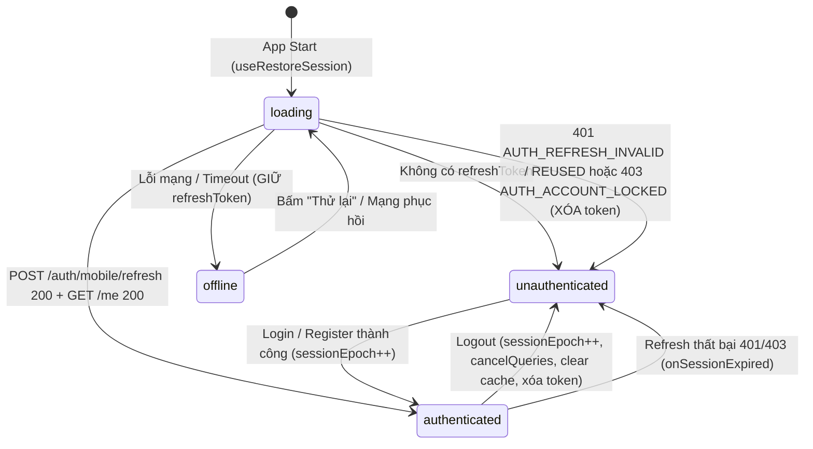

# EDU-TDS-M-001 — ĐẶC TẢ THIẾT KẾ KIỂM THỬ EDUMY MOBILE (TEST DESIGN SPECIFICATION)

> **Chuẩn áp dụng**: ISO/IEC/IEEE 29119-3 · ISO/IEC/IEEE 29119-4 · ISO/IEC 25010 · OWASP MASVS v2.

| Thuộc tính | Giá trị |
| :--- | :--- |
| **Mã tài liệu** | `EDU-TDS-M-001` |
| **Kế hoạch tham chiếu** | [`EDU-TP-M-001_Test_Plan.md`](EDU-TP-M-001_Test_Plan.md) |
| **Danh mục yêu cầu** | [`requirements_inventory.csv`](requirements_inventory.csv) |
| **Sổ Test Case** | [`EDU-TCS-M-001_Test_Cases.xlsx`](EDU-TCS-M-001_Test_Cases.xlsx) |

---

## 1. Kiến trúc Phân rã Kịch bản Kiểm thử (Test Scenario Decomposition)

Toàn bộ yêu cầu của **Edumy Mobile** được phân rã thành **10 Module** (`M-M01`..`M-M08`, `M-API`, `M-REG`) và **28 Kịch bản kiểm thử (`TS-M-*`)**:

| Module | Mã Kịch bản | Tên Kịch bản kiểm thử | Kỹ thuật thiết kế chính (ISO 29119-4) |
| :---: | :---: | :--- | :--- |
| **`M-M01`** | `TS-M-M01-001` | Đăng nhập, Đăng ký, Quên mật khẩu & Gửi lại email xác thực (`/auth/mobile/*`) | EP, BVA, Error Guessing |
| **`M-M01`** | `TS-M-M01-002` | Khôi phục phiên `useRestoreSession` (`AC-M03`): giữ token khi offline, xóa khi `INVALID`/`REUSED`/`LOCKED` | State Transition, Decision Table |
| **`M-M01`** | `TS-M-M01-003` | Refresh token single-flight, `sessionEpoch` guard khi đăng xuất giữa chừng & đổi mật khẩu thu hồi phiên (`AC-M04`) | State Transition, Error Guessing |
| **`M-M02`** | `TS-M-M02-001` | Danh sách khóa học, Tìm kiếm có dấu/không dấu (`UC-G02`, `D-09`), Lọc danh mục/giá & `SortPicker` 4 kiểu (`UC-G03`) | Pairwise, EP, Use Case |
| **`M-M02`** | `TS-M-M02-002` | Chi tiết khóa học & Bảng quyết định 5 nhánh `resolveCourseAction` (`BR-MOBILE-SCOPE`) | Decision Table |
| **`M-M02`** | `TS-M-M02-003` | Xem trước bài học không cần đăng nhập (`UC-G11`), Danh sách đánh giá & Khóa học bị ẩn (`404`) | Use Case, Error Guessing |
| **`M-M03`** | `TS-M-M03-001` | Ghi danh miễn phí (`UC-S15`) & Danh sách Học tập phân trang vô hạn (`AC-M01`) | Use Case, BVA |
| **`M-M03`** | `TS-M-M03-002` | Phòng học & Màn hình Bài học (`AC-M02`): visit, Bài trước/Bài sau, hoàn thành thủ công, `expo-video`/WebView, Quiz handoff | State Transition, Use Case |
| **`M-M03`** | `TS-M-M03-003` | Cấp chứng chỉ tự động 100% (`AC-M08`) & Đồng bộ tiến độ/mua hàng hai chiều Web ↔ App | Use Case, State Transition |
| **`M-M04`** | `TS-M-M04-001` | Hỏi đáp bài học (`AC-M09`): danh sách, lọc, đặt câu hỏi, trả lời, đánh dấu giải quyết `{resolved}`, xóa có `confirm` | Use Case, Decision Table |
| **`M-M04`** | `TS-M-M04-002` | Đánh giá khóa học (`AC-M10`): tạo, sửa, rút (`DELETE /reviews/{id}`) & chặn sửa đánh giá bị Admin ẩn (`AC-30`) | State Transition, Error Guessing |
| **`M-M05`** | `TS-M-M05-001` | Hồ sơ cá nhân (`UC-G09`: BVA độ dài họ tên 0/1/100/101) & Đổi mật khẩu (`PUT /me/password`) | BVA, EP |
| **`M-M05`** | `TS-M-M05-002` | Chứng chỉ số (`AC-M12..M13`): tải PDF kèm Bearer + chia sẻ trên native, mở `verifyUrl` trên web, sao chép link | Use Case, Decision Table |
| **`M-M06`** | `TS-M-M06-001` | Quy tắc hiển thị Tab Giảng viên (`shouldShowInstructorTab`) & Tổng quan Doanh số / Thu nhập thực nhận (`AC-M14`) | Decision Table |
| **`M-M06`** | `TS-M-M06-002` | Danh sách khóa học phụ trách, Học viên không lộ email (`UC-I19`), Lời mời đồng GV (`UC-I14..I15`) & Trả lời Q&A (`UC-I21`, `AC-M15..M16`) | Use Case, Error Guessing |
| **`M-M06`** | `TS-M-M06-003` | Thu nhập `BR-PAY-HOLD` (`holdDays=0`, `holdDays=7`, `nextMaturityAt`) & Lịch sử bút toán (`AC-M17`) | Decision Table, BVA |
| **`M-M06`** | `TS-M-M06-004` | Tài khoản nhận tiền (4 số cuối, `currentPassword`, xóa mật khẩu sau submit) & Rút tiền BVA / 4 mã lỗi / Hủy (`AC-M18`) | BVA, Decision Table, State Transition |
| **`M-M07`** | `TS-M-M07-001` | Quảng cáo Hybrid (`Q-M01`): AdMob Test IDs, House Ads loại trừ khóa đã mua, cấm quảng cáo trong `app/learn/**`, suy giảm êm | Decision Table, Error Guessing |
| **`M-M08`** | `TS-M-M08-001` | Banner Offline + Thử lại (`onlineManager`), `useForegroundSync`, `parseAppError` v2 (`fieldErrors`, `429 Retry-After`, `traceId`) | State Transition, EP |
| **`M-M08`** | `TS-M-M08-002` | Kiểm chứng 4 trạng thái (`Loading / Empty / Error / Content`) trên toàn bộ 23 màn hình & Tuân thủ `BR-MOBILE-SCOPE` | Use Case, Error Guessing |
| **`M-API`** | `TS-M-API-001` | Kiểm thử Hợp đồng 31 Endpoint Mobile v2 với Backend thực tế & Schema `openapi.json` | EP, Schema Validation |
| **`M-REG`** | `TS-M-REG-001` | Hồi quy `SortPicker` bottom sheet & toàn bộ Must-have Unit/Integration Tests (`60-testing.md`) | Use Case, Regression |
| **`NFR`** | `TS-M-NFR-SEC` | Bảo mật Mobile theo OWASP MASVS v2 (`STORAGE`, `AUTH`, `NETWORK`, `CODE`) & IDOR Mobile API (`NFR-01`) | Error Guessing, Decision Table |
| **`NFR`** | `TS-M-NFR-PERF` | Hiệu năng 50 CCU × 3 lượt trên 8 kịch bản API Mobile (`NFR-05`, `p95 <= 3000ms`) & Thời gian phản hồi UI | BVA |
| **`NFR`** | `TS-M-NFR-REL` | Độ tin cậy: mất mạng đột ngột, khôi phục phiên sau reload/restart, chống double-submit | State Transition, Error Guessing |
| **`NFR`** | `TS-M-NFR-USA` | Khả dụng (`NFR-07`): 360dp, `accessibilityLabel` tiếng Việt, touch target >= 44pt, định dạng tiền `499.000 đ` & ngày giờ VN | BVA, Use Case |
| **`NFR`** | `TS-M-NFR-COMP` | Tương thích đa nền tảng: Jest, Web (Chrome), Android API 30 (360dp), Android API 34 (Tablet), iOS | Pairwise |
| **`NFR`** | `TS-M-NFR-MNT` | Bảo trì & Triển khai (`NFR-10`): `tsc`, `eslint --max-warnings=0`, `jest --coverage`, quy tắc kiến trúc & khởi chạy sạch | Use Case |

---

## 2. Thiết kế Bảng Quyết định & Sơ đồ Chuyển trạng thái Trọng tâm

### 2.1. Bảng quyết định `resolveCourseAction` (`BR-MOBILE-SCOPE` — 5 Nhánh)

| # | `viewer.isInstructor` | `viewer.owned` | `isFree` | `isLoggedIn` | `lastAccessedLessonId` | `primaryAction` | `primaryLabel` | `notice` | TC truy vết |
| :-: | :-: | :-: | :-: | :-: | :-: | :--- | :--- | :--- | :--- |
| 1 | `true` | bất kỳ | bất kỳ | `true` | bất kỳ | `null` | `null` | `"Bạn là giảng viên khóa này"` | `TC-M-M02-FN-005` |
| 2a | `false` | `true` | bất kỳ | `true` | `null` | `'OPEN_LEARNING'` | `"Vào học"` | `undefined` | `TC-M-M02-FN-005` |
| 2b | `false` | `true` | bất kỳ | `true` | `168` (`>0`) | `'OPEN_LEARNING'` | `"Học tiếp"` | `undefined` | `TC-M-M02-FN-005` |
| 3 | `false` | `false` | `true` | `true` | `null` | `'FREE_ENROLL'` | `"Ghi danh miễn phí"` | `undefined` | `TC-M-M02-FN-006` |
| 4 | `null` | `null` | `true` | `false` | `null` | `'LOGIN_TO_ENROLL'` | `"Đăng nhập để ghi danh"` | `undefined` | `TC-M-M02-FN-006` |
| 5 | `false`/`null` | `false`/`null` | `false` | `true`/`false` | `null` | `'BUY_ON_WEB'` | `"Mua trên website"` | `"Khóa học trả phí được mua trên website"` | `TC-M-M02-FN-007` |

### 2.2. Bảng quyết định Hiển thị Tab Giảng viên (`shouldShowInstructorTab` — `D-M01`)

| # | `me` | `me.roles` chứa `'INSTRUCTOR'` (không phân biệt hoa/thường) | `earningsSummary.hasEarnings` | Hiển thị Tab Giảng viên? | TC truy vết |
| :-: | :-: | :-: | :-: | :-: | :--- |
| 1 | `null` (Khách) | — | — | `false` | `TC-M-M06-FN-001` |
| 2 | Học viên thường (`["STUDENT"]`) | `false` | `false` | `false` | `TC-M-M06-FN-001` |
| 3 | Giảng viên mới (`["STUDENT", "INSTRUCTOR"]`) | `true` | `false` | `true` | `TC-M-M06-FN-001` |
| 4 | Đồng GV / GV bị thu hồi quyền (`["STUDENT"]`) nhưng có thu nhập | `false` | `true` | `true` | `TC-M-M06-FN-001` |
| 5 | Giảng viên có thu nhập (`["INSTRUCTOR"]`) | `true` | `true` | `true` | `TC-M-M06-FN-001` |

### 2.3. Phân tích Giá trị Biên (BVA) & Bảng Quyết định Rút tiền (`M-M06`)

- **Biên số tiền rút (`minWithdrawal = 1.000.000`, `availableBalance = 2.500.000`)**:
  - `0`, `-100000` → Không hợp lệ (`"Vui lòng nhập số tiền hợp lệ."`)
  - `1000000.5` (số lẻ thập phân) → Không hợp lệ (`"Số tiền rút phải là số nguyên VNĐ."`)
  - `999999` (`min - 1`) → Không hợp lệ (`WITHDRAWAL_BELOW_MINIMUM` / `"Số tiền rút tối thiểu là 1.000.000 đ."`)
  - `1000000` (`min`) → Hợp lệ (`200/201`, trạng thái `requested` — `"Đang chờ duyệt"`)
  - `2500000` (`max = availableBalance`) → Hợp lệ
  - `2500001` (`max + 1`) → Không hợp lệ (`WITHDRAWAL_EXCEEDS_BALANCE`)
- **4 Mã lỗi Server & Điều hướng UX (`resolveWithdrawalErrorAction`)**:
  1. `PAYOUT_ACCOUNT_REQUIRED` (422) → `confirm_payout_account` → chuyển tới `/instructor/payout-account`.
  2. `WITHDRAWAL_ALREADY_OPEN` (409) → `go_withdrawals_list` → chuyển tới `/instructor/withdrawals`.
  3. `WITHDRAWAL_EXCEEDS_BALANCE` / `WITHDRAWAL_BELOW_MINIMUM` (422) → `amount_field_error` ngay dưới ô nhập số tiền.
  4. `WITHDRAWAL_MONTHLY_LIMIT_REACHED` (409) → `banner_error` thông báo giới hạn tối đa 1 lần/tháng.

### 2.4. Sơ đồ Chuyển trạng thái Phiên làm việc (`Zustand Session Store` + `sessionEpoch`)

